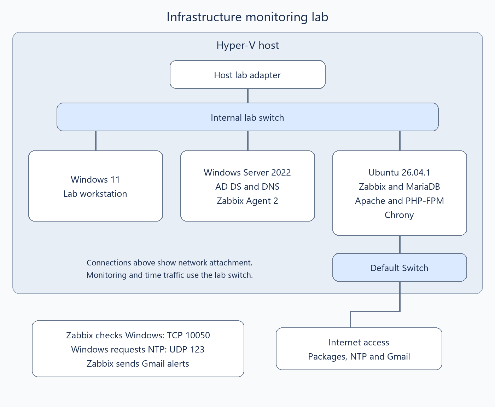

# Infrastructure Monitoring Lab

**Hyper-V · Windows Server · Ubuntu · Zabbix**

I built a small network of virtual computers and set up a system to watch their health. My goal was to know when monitoring lost contact with a Windows server, receive an email about it, and check the records to understand what happened.

A virtual machine is a separate computer running inside a physical computer. This let me practice with Windows and Linux servers on one machine. This is a home lab, not a production system or a claim of workplace incident-response experience.

## What I built

I used **Hyper-V** to run the virtual computers. My **Windows Server** provided directory services, which manage the lab's domain, and **DNS**, which helps computers find each other by name.

On **Ubuntu**, a Linux operating system, I installed **Zabbix**. Zabbix collects information about computers and shows it in a dashboard. A small program on Windows called **Agent 2** supplies the Windows health information. I also connected Zabbix to **Gmail** so I could receive problem and recovery messages without watching the dashboard constantly.

The lines show how the machines connect to the lab network. Ubuntu has a second connection for internet access. [Architecture details](docs/architecture.md) explain the parts and how they communicate.

## What I got working

| My goal | How I checked it |
|---|---|
| Get the lab computers talking to each other | I sent network test requests and checked the replies. |
| Open a working monitoring dashboard | I fixed the website setup and reached the Zabbix dashboard. |
| Collect useful information from Windows | I checked processor, memory, storage, and background-service readings. |
| Get the computers using accurate time | I checked their clocks and the time sources they actually selected. |
| Receive a problem email and a recovery email | I tested Gmail and checked the two recorded notification sends. |
| Understand a monitoring interruption | I compared alert times with Windows startup and service records. |

In this screenshot, Zabbix recorded a problem at **23:07:16** and a recovery at **23:12:16** on October 30, 2026. Both email records say **Sent**. I also confirmed receiving both emails during the lab, although I did not save screenshots of their arrival times.

**The five minutes is how long Zabbix recorded the problem.** I did not measure how quickly it noticed the original failure. Losing the monitoring connection also does not prove that the Windows server's other services were down for those five minutes.

## What I had to work through

The network did not work the same way from every machine. One virtual computer could reach the Windows server while my physical computer could not. I checked the physical computer's lab address, corrected it, and tested again.

The Zabbix website also took several checks. At first the browser could not find the page. Later it displayed program code instead of a usable website. I checked the web server settings and how it passed requests to PHP, the software that builds the page, until the dashboard loaded.

A clock warning gave me another problem to investigate. Turning on a time service was not enough: I had to check that the clocks were actually synchronized and using the intended source.

Finally, I found a shutdown record written on October 30 that described something that happened on October 28. Reading the full message kept me from mixing two separate events into one explanation.

## Where to start

- **[Short visual walkthrough](evidence/README.md):** the main problems, checks, and results in plain language.
- **[All 142 screenshots](evidence/archive.md):** an explanation for every image, organized into seven chapters.
- **[Build steps](docs/setup.md):** how I put the lab together.
- **[Email alerts](docs/alerting.md):** how the problem and recovery messages worked.
- **[Troubleshooting notes](docs/troubleshooting.md):** what failed and how I narrowed it down.
- **[October 30 investigation](docs/incidents/2026-10-30-monitoring-interruption.md)** and **[October 28 shutdown finding](docs/incidents/2026-10-28-unclean-shutdown.md)**.
- **[What the evidence can and cannot show](docs/verification.md)**.

## What I would do next

For another controlled test, I would record exactly when I stopped the agent, when Zabbix detected the problem, and when each email arrived. That would let me measure the different delays instead of guessing. I would also improve the security of the website and monitoring connections before using this setup as a model for a production system.

The repository remains private while I review it for public release.
