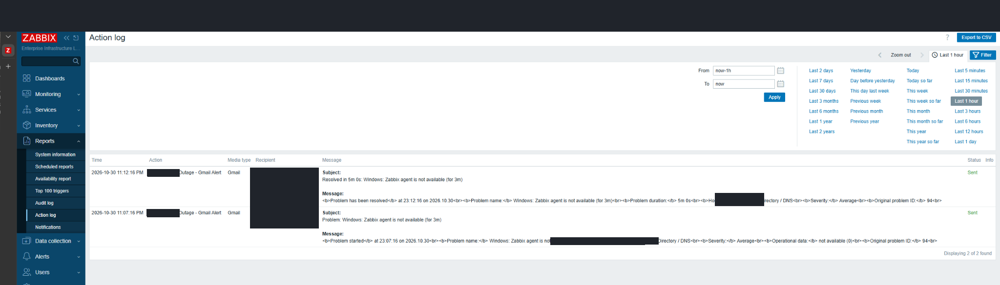
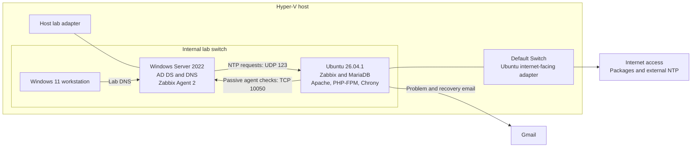

# Enterprise Infrastructure Monitoring Lab

**Hyper-V · Windows Server · Ubuntu · Zabbix · PowerShell · Linux administration**

I built this lab to practice the work that comes after a server is installed: checking that it can communicate, collecting useful health data, getting an alert when monitoring breaks, and figuring out what the logs actually say about recovery.

The final setup uses an Ubuntu VM running Zabbix to monitor a Windows Server directory-services and DNS VM. I connected Gmail problem and recovery notifications, worked through a cross-platform time-sync issue, and investigated an October 30 monitoring interruption using Windows events and the Zabbix action log.

This is a home lab built around enterprise administration tools. It is not a production deployment or a claim of production incident-response experience.

## The result

*The Action log shows both Gmail notifications marked Sent. The problem was recorded at 23:07:16 and resolved at 23:12:16 on October 30, 2026. I also confirmed receiving both emails during the lab; the archive contains the send log, not mailbox-arrival screenshots.*

| What I completed | Evidence |
|---|---|
| Connected Windows and Linux VMs across a Hyper-V lab network | [Network checks and Ubuntu setup](evidence/chapters/03-ubuntu-build.md) |
| Installed Zabbix 7.4.16 with MariaDB, Apache, and PHP-FPM | [Database import through working dashboard](evidence/chapters/04-zabbix-stack.md) |
| Collected Windows performance and service data with Agent 2 | [Agent installation and monitoring checks](evidence/chapters/05-windows-monitoring.md) |
| Corrected clock synchronization and verified the selected time source | [Time-sync investigation](evidence/chapters/06-time-synchronization.md) |
| Tested Gmail delivery and configured problem/recovery operations | [Alerting demonstration](docs/alerting.md) |
| Correlated boot, service, and alert records without overstating the cause | [October 30 incident report](docs/incidents/2026-10-30-monitoring-interruption.md) |

**The five-minute figure is the recorded problem duration. I did not measure fault-to-detection latency.** Agent unavailability also does not establish five minutes of AD or DNS downtime.

## How the lab fits together

The diagram uses role labels instead of real machine names or addresses. [Architecture and topology](docs/architecture.md) explains the two Ubuntu network interfaces and the management path.

## What took the most troubleshooting

The network checks taught me to test each path separately. The workstation could reach the directory server while the Hyper-V host still had an APIPA address on its lab adapter. Later, Apache was running but `/zabbix` returned a 404. Fixing the path exposed another issue: the browser showed PHP source. I checked the Apache modules and PHP-FPM handler before the frontend finally loaded.

Time synchronization was another useful lesson. A running NTP service and a successful configuration command were not enough. I checked Chrony's offset and access rules, then checked the time source Windows was actually using. The final status showed the Linux server as the Windows NTP source.

During the October 30 investigation, I found an unexpected-shutdown event whose message referred to October 28. Keeping the event's recording time separate from the shutdown it described prevented me from writing the wrong incident story.

## Read the project

- **[Short screenshot walkthrough](evidence/README.md):** the key decisions, failures, and results.
- **[All 142 annotated screenshots](evidence/archive.md):** seven chapters covering the full supplied archive.
- **[Setup record](docs/setup.md):** the build sequence and verification checkpoints.
- **[Troubleshooting notes](docs/troubleshooting.md):** symptoms, checks, and what each result established.
- **[October 30 incident](docs/incidents/2026-10-30-monitoring-interruption.md)** and **[October 28 shutdown finding](docs/incidents/2026-10-28-unclean-shutdown.md)**.
- **[Evidence limits](docs/verification.md)**.

## What I would improve next

For the next controlled outage test, I would record the exact service-stop time, fresh item timestamps after recovery, and mailbox arrival times. That would let me measure detection and notification delays separately. I would also harden the lab's web and agent connections, which the captured setup shows without encryption, before treating it as a model for a production deployment.

The repository remains private while I review the sanitized evidence for public release.
