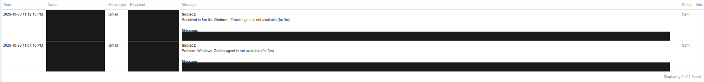
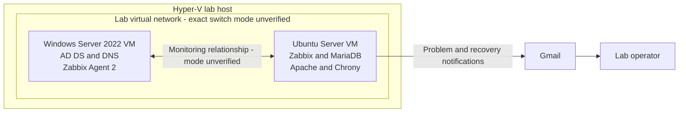

# Enterprise Infrastructure Monitoring Lab

**Hyper-V · Windows Server · Ubuntu · Zabbix · Operational incident investigation**

A hands-on infrastructure lab connecting Windows service monitoring to automated Gmail problem and recovery notifications. The central case study correlates Zabbix notifications with Windows boot and service events to explain a monitoring interruption without overstating its cause.

> Private review edition. Four original screenshots were inspected and sanitized for this repository. Platform and setup details available only in the lab conversation are labeled separately from screenshot-verified results. This is a home lab, not a production enterprise deployment.

## Start here

**The operational story:** monitor a Windows server from Zabbix, deliver an automated problem/recovery notification pair, and use Windows events to investigate the interruption. The investigation separates a startup-associated monitoring problem from an earlier unclean shutdown.

| For a quick review | For a technical review |
|---|---|
| [Annotated screenshot walkthrough](evidence/README.md) — four images with findings and explanations | [Incident report](docs/incidents/2026-10-30-monitoring-interruption.md) — timeline, interpretation, and evidence limits |
| Results and architecture below | [Setup](docs/setup.md) and [troubleshooting](docs/troubleshooting.md) — implementation record and diagnostic approach |

*Two notification records show Gmail as the media type and Sent as the result. The recovery subject records a five-minute problem. Mailbox receipt was separately confirmed by the lab owner.*

## What the evidence demonstrates

| Result | Evidence |
|---|---|
| Automated problem and recovery notifications | Zabbix Action log: two Gmail messages with `Sent` status; lab owner separately confirmed receiving both |
| Five-minute recorded problem | Problem at 23:07:16 and recovery at 23:12:16 on October 30, 2026 |
| Agent recovery | Windows Event 7036: Zabbix Agent 2 entered the running state at 20:08:36 Windows local time |
| Service configuration and boot context | Agent shown Running / Automatic; last boot displayed as 20:06:29 |
| Separate historical shutdown finding | Event 6008 recorded October 30 names an unexpected shutdown on October 28 |

**Five minutes is the Zabbix problem duration, not detection latency.** Neither the actual start of agent unavailability nor independent mailbox arrival timestamps were captured. This case does not establish an agent crash, a manual fix, or five minutes of application downtime.

## Architecture

This is a logical diagram. Machine labels are role descriptions, not real hostnames. Network addressing, routing, port forwarding, active/passive agent mode, and time-source direction are intentionally not invented. See [architecture and topology](docs/architecture.md).

## Explore the project

- [Setup record and reconstruction checklist](docs/setup.md)
- [Automated Gmail alert demonstration](docs/alerting.md)
- [October 30 monitoring incident](docs/incidents/2026-10-30-monitoring-interruption.md)
- [October 28 unclean shutdown finding](docs/incidents/2026-10-28-unclean-shutdown.md)
- [Troubleshooting runbook](docs/troubleshooting.md)
- [Annotated screenshot walkthrough](evidence/README.md)
- [Evidence boundaries and remaining checks](docs/verification.md)

## Operational lessons

The most useful outcome was separating what happened from what the logs could prove. A running service is one recovery signal; Zabbix resolution and notification delivery are separate signals. An unexpected-shutdown event's recording time is not necessarily the time of the shutdown it describes. Clock display differences must be accounted for before correlating systems.

The lab exercises virtualization, Windows/Linux administration, service monitoring, notification validation, and evidence-based troubleshooting. The incident-response work here concerns infrastructure availability; it does not claim a security breach investigation.

## Scope and next improvements

The lab conversation reports Hyper-V networking, Windows Server 2022 AD DS/DNS, Ubuntu-hosted Zabbix/MariaDB/Apache/Chrony, and cross-platform time troubleshooting. The four available screenshots directly substantiate the incident and notification results, not every deployment detail.

Before claiming a fully reproducible build, capture sanitized versions, virtual-switch configuration, agent mode, template/trigger settings, and time synchronization output. A future controlled test should record the actual fault start and mailbox receipt time to measure detection and notification latency separately.
