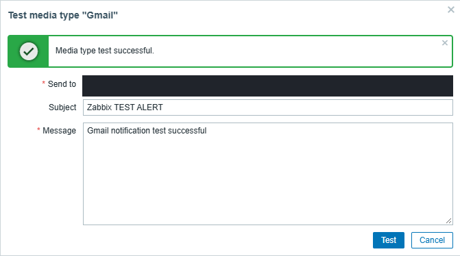
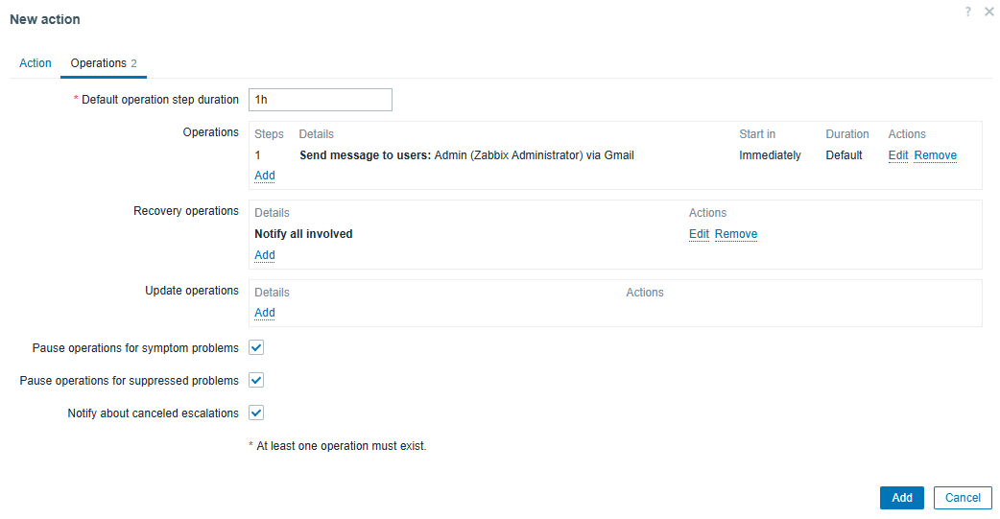

# Gmail problem and recovery alerts

[Project overview](../README.md) · [Alerting screenshots](../evidence/chapters/07-alerting-and-investigation.md)

I wanted the lab to tell me when monitoring failed and when it recovered. I first tested the email path, then connected it to a specific Zabbix trigger. That kept a successful test email separate from proof that the trigger action actually ran.

Zabbix uses a trigger to identify a problem condition and an action to define the response. I configured the Gmail media type as the delivery channel and added separate operations for problem and recovery notifications.

| Step | What I configured or checked | Screenshot |
|---|---|---|
| Provider | Gmail with username/password authentication; app-password preparation screen captured separately | 125, 128 |
| Send test | Media test reported success | 129 |
| Recipient | Enabled Gmail media, all severities, continuous schedule | 130 |
| Conditions | Directory-server host AND its agent-unavailable trigger | 131 |
| Problem operation | Send to the designated Zabbix user through Gmail, starting immediately | 132 |
| Recovery operation | Notify all involved | 133 |
| Enabled action | Action added and enabled | 134 |
| Actual result | Problem and recovery records both marked Sent | 139 |

The initial generic SMTP form is an intermediate screen, not the final Gmail configuration. The screenshots do not preserve a complete final SMTP configuration or any app password. I have not filled in missing port or TLS settings from assumptions.

## Notification evidence and timing limits

The Action log records a problem notification at **23:07:16** and a recovery notification at **23:12:16** on October 30, 2026. Both use Gmail and show **Sent**. I confirmed receiving both messages during the lab conversation, but did not capture independent mailbox-arrival timestamps in this archive.

The five minutes between those event timestamps is the recorded problem duration. The operation's Immediately setting is scheduling behavior after the action runs; it does not establish instant fault detection or instant mailbox delivery. The fault start, polling history, effective timeout macro, and receipt times needed to measure those delays were not all captured.

See the [incident report](incidents/2026-10-30-monitoring-interruption.md) for the boot and service-event comparison.
