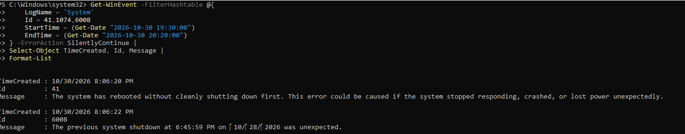

# Separate finding: October 28 unclean shutdown

The Windows screenshot shows Event 6008 recorded on October 30 at 20:06:22 local time. Its message identifies the **previous unexpected shutdown at 18:45:59 on October 28, 2026**. Event 41 was recorded on October 30 at 20:06:20.

Using the conversation's stated Pacific timezone, the previous shutdown corresponds to October 28 at 21:45:59 Eastern (October 29 at 01:45:59 UTC). The screenshot itself does not display the timezone identifier.

The event recording time and the shutdown time inside the event message describe different things. These entries do not establish that a new crash occurred on October 30. They also do not identify a root cause for the October 28 shutdown.

Possible explanations include an abrupt VM power-off, host interruption, or guest crash, but none is confirmed. Event 41 alone may not provide enough information to determine why a system restarted. [Microsoft's Event 41 investigation guidance](https://learn.microsoft.com/en-us/troubleshoot/windows-client/performance/event-id-41-restart).

No bugcheck data, crash dump, Hyper-V host event history, or user power-action history was preserved in the available evidence. This remains an unresolved historical cause, separate from the recovered October 30 monitoring incident.
