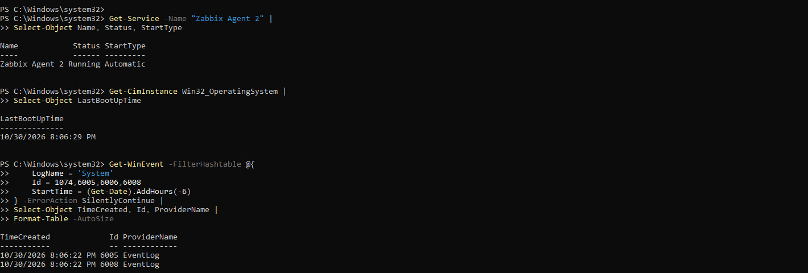
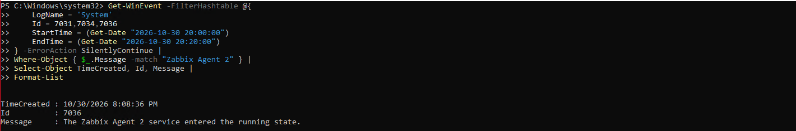

# Incident: startup-associated monitoring interruption

**Date:** October 30, 2026  
**Affected function:** Zabbix Agent 2 monitoring of the Windows directory server VM  
**Outcome:** Service running; Zabbix problem resolved; problem/recovery notifications sent and receipt confirmed  
**Cause assessment:** Startup association is supported; exact initiating cause is unproven

## Evidence and time basis

Windows screenshots show local times without a timezone identifier. The source conversation identifies Windows as Pacific and Zabbix as Eastern. The correlation below uses that stated three-hour difference; timezone configuration screenshots and clock-offset measurements are not available. UTC values are derived using PDT (UTC-07:00) and EDT (UTC-04:00), not independently captured timestamps.

| Event | Windows local / Pacific | Eastern | UTC |
|---|---|---|---|
| Last boot, reported by Windows | Oct 30 20:06:29 | Oct 30 23:06:29 | Oct 31 03:06:29Z |
| Zabbix problem and problem send | Oct 30 20:07:16, derived | Oct 30 23:07:16 | Oct 31 03:07:16Z |
| Event 7036: agent entered running state | Oct 30 20:08:36 | Oct 30 23:08:36 | Oct 31 03:08:36Z |
| Zabbix resolution and recovery send | Oct 30 20:12:16, derived | Oct 30 23:12:16 | Oct 31 03:12:16Z |

## Investigation

1. Confirmed the current Zabbix Agent 2 service state was Running and startup type Automatic.
2. Read Windows last boot time and startup/shutdown events.
3. Inspected Events 41 and 6008. Event 6008 names an October 28 shutdown, making it a separate historical finding.
4. Queried System Events 7031, 7034, and 7036 for Zabbix Agent 2 over the displayed 20:00–20:20 Windows-local interval. The screenshot shows one matching Event 7036 at 20:08:36 indicating Running. No unexpected-termination record appears in that output. This is bounded evidence, not proof that an agent crash never occurred.
5. Correlated service startup with the Zabbix notification timeline and the owner's confirmation of both receipts.

## Interpretation and limits

The Windows boot precedes the Zabbix problem by 47 seconds under the stated timezone conversion. Agent startup follows the problem and precedes recovery. This supports a startup-associated monitoring interruption; it does not prove an agent crash or establish which action restored monitoring.

The interval from agent Running to Zabbix recovery is 3m 40s. Polling or trigger recovery behavior is a possible explanation, but the configuration and item history needed to confirm it are absent. No claim is made that a manual service restart caused recovery.

| Metric | Result | Meaning |
|---|---|---|
| Zabbix problem duration | 5m 00s | Recorded resolution minus recorded problem start |
| Fault-to-detection latency | Not measured | Actual fault onset unknown |
| Mailbox delivery latency | Not measured | Independent receipt times absent |
| AD/DNS service downtime | Not established | Agent availability is not a direct application-availability measurement |

## Recovery evidence

The [notification evidence](../alerting.md) supplies the Zabbix recovery result. No remediation command is documented as the proven fix. Capture fresh item timestamps in a future test to strengthen post-recovery validation.
