# Getting the lab network talking

[Walkthrough](../README.md) · [Full archive](../archive.md)

I began by establishing the network baseline for the existing Windows directory server and workstation. I checked VM state, virtual-switch membership, addressing, and reachability from both the guests and the Hyper-V host. Comparing those paths helped me isolate the host adapter issue without assuming a successful guest test validated the entire network.

## 001 — Checking administrative permissions

I first ran Get-VM without the required permissions and received an access error. I reopened PowerShell with administrator privileges before continuing. Establishing the correct execution context was necessary before interpreting any VM inventory results.

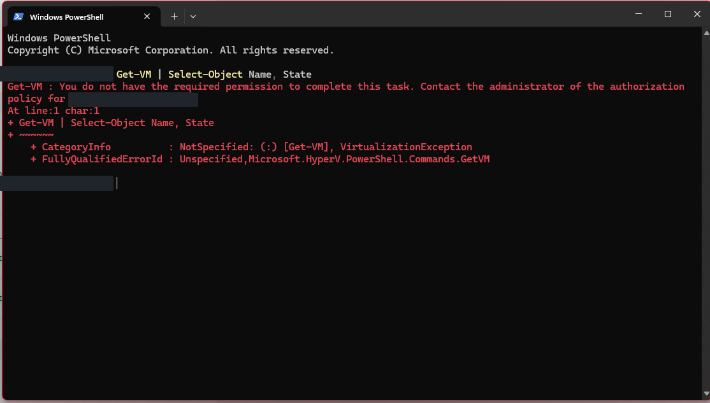

## 002 — Establishing VM state

In an elevated PowerShell session, I identified the existing directory server and workstation. Both were in a saved state rather than Running. I checked this baseline before beginning connectivity tests.

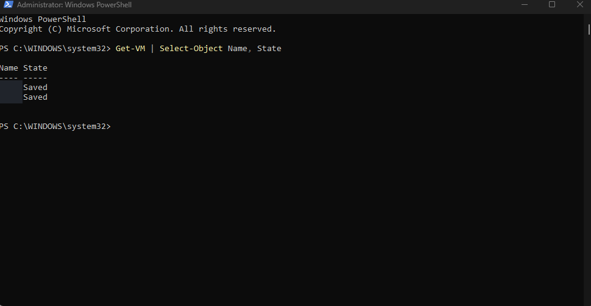

## 003 — Checking the virtual switches

I inspected the internal lab switch, the Default Switch, and the VM adapter connections before changing the network.

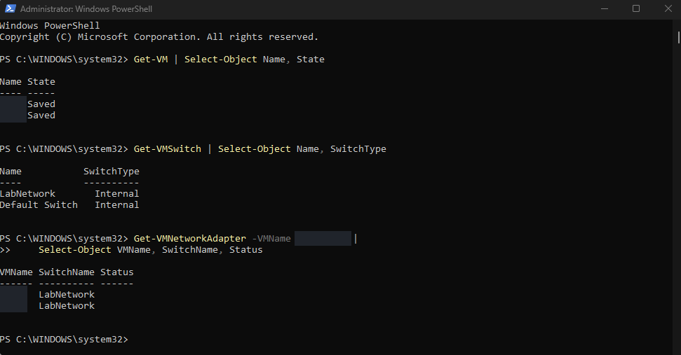

## 004 — Starting the lab machines

I started the two existing VMs and checked that their state changed to Running. This established the starting point for the network checks.

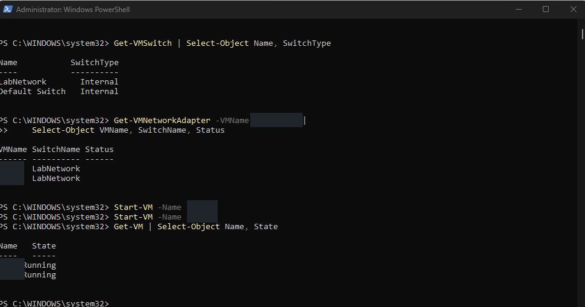

## 005 — Checking directory-server addressing

I reviewed the server's static IPv4 configuration, subnet mask, and loopback DNS settings. The actual addresses and domain name are removed from this copy.

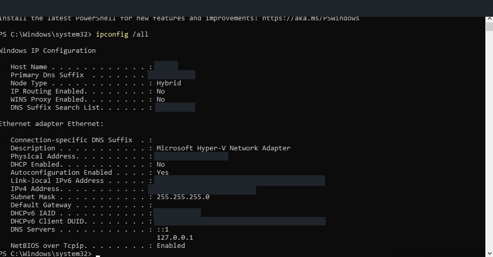

## 006 — Checking the workstation

I checked the Windows 11 workstation's static address and its DNS setting, which pointed at the directory server. This gave me both ends of the client-to-server path to compare.

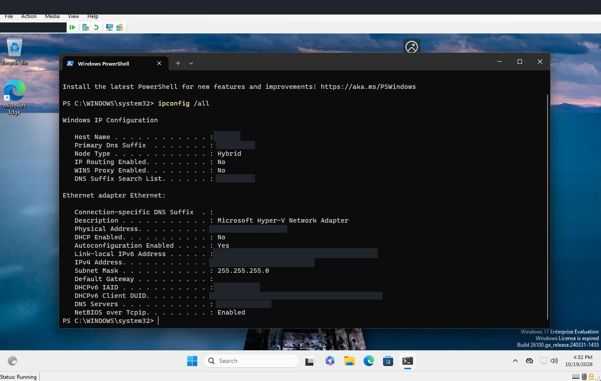

## 007 — Fixing a ping command

I initially pasted an angle-bracket placeholder into PowerShell and got a parser error. After using the actual address, all four ping requests received replies.

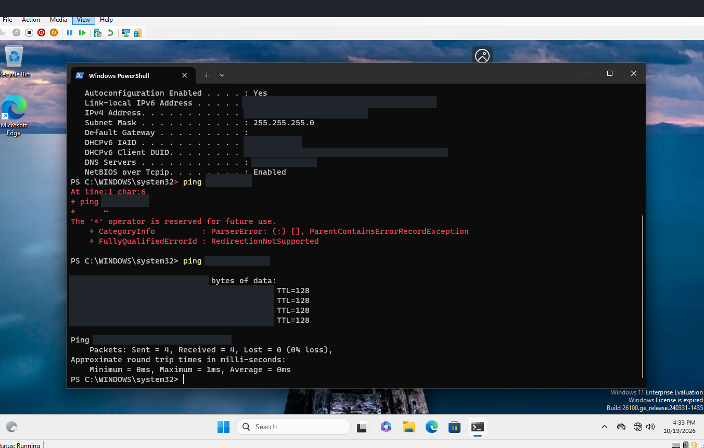

## 008 — Testing from the Hyper-V host

The workstation could reach the server, but Test-Connection from the host failed with a resource-related error. I needed to inspect the host's own lab adapter instead of assuming every path worked.

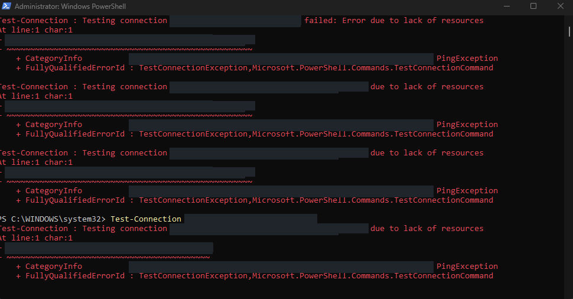

## 009 — Identifying an APIPA address

I found an APIPA address on the host's lab adapter. APIPA is fallback addressing used when an interface does not have its intended configuration; here, it placed the host outside the lab's configured IPv4 subnet. This gave me a specific addressing issue to correct.

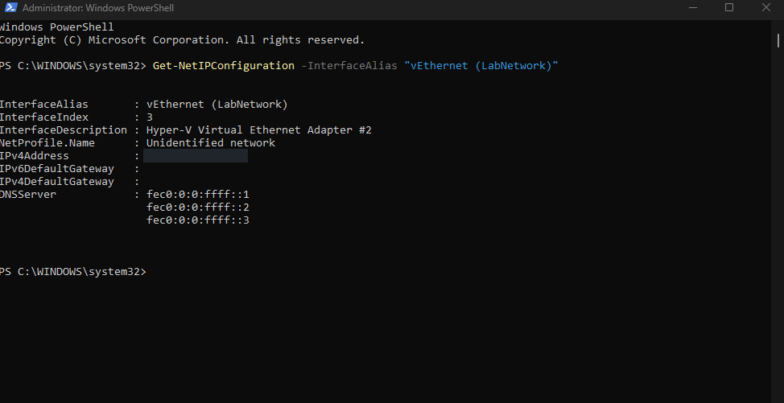

## 010 — Assigning the host lab address

I listed the host adapters and assigned a static address to the lab adapter. The immediate output included Tentative and Invalid states, so this command alone was not my final validation.

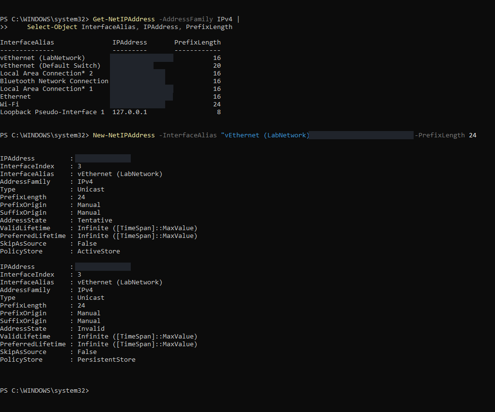

## 011 — Rechecking the host adapter

I queried the adapter again to confirm its static address and /24 prefix. I then moved on to a connectivity test.

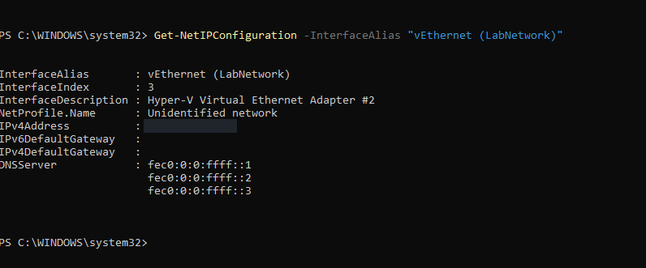

## 012 — Confirming host-to-server connectivity

The host received four replies from the directory server. That gave me a successful check after correcting the host's lab addressing.

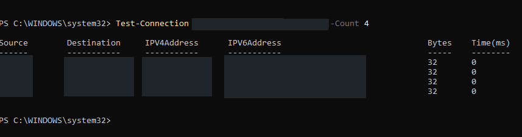

## 013 — Checking available resources

I reviewed available memory, VM allocations, and free disk space before adding another VM. These are the allocations I captured, not a recommendation to give every lab VM the same CPU count.

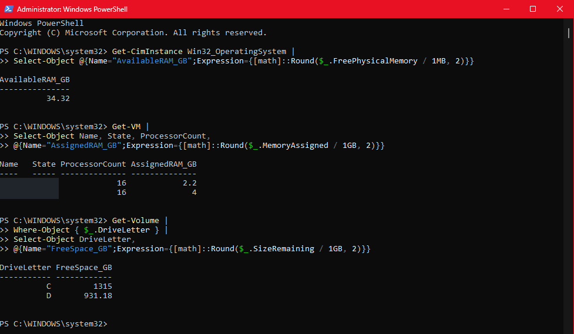
