# The early Windows VM build

[Walkthrough](../README.md) · [Full archive](../archive.md)

This section records an early Windows monitoring VM build, including OS installation, adapter configuration, routing, and DNS checks. I retained this branch as part of the project history. The final monitoring platform runs on Ubuntu; these captures do not establish a completed PRTG deployment.

## 014 — An early Windows monitoring VM

I inspected a Generation 2 Windows VM with four virtual processors and 4 GB of startup memory. This was an early branch of the build, before the Ubuntu monitoring server documented later.

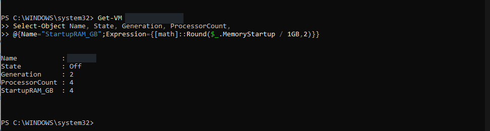

## 015 — Checking that VM's disk and network

I checked its lab-switch connection and 100 GB dynamic virtual disk. This screenshot records infrastructure preparation; it does not demonstrate a working monitoring application on that Windows VM.

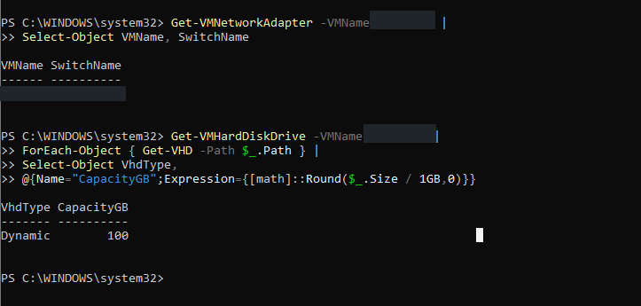

## 016 — Starting Windows Server setup

I worked through the Windows Server installer language and keyboard screen for the early Windows VM.

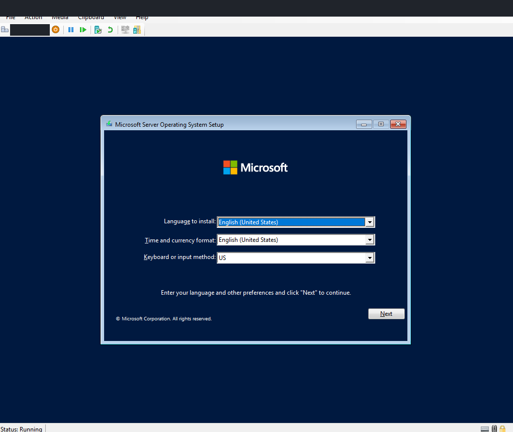

## 017 — Reviewing installation choices

I reached the Windows installation-type screen. This image captures the available choices, rather than proving a final selection by itself.

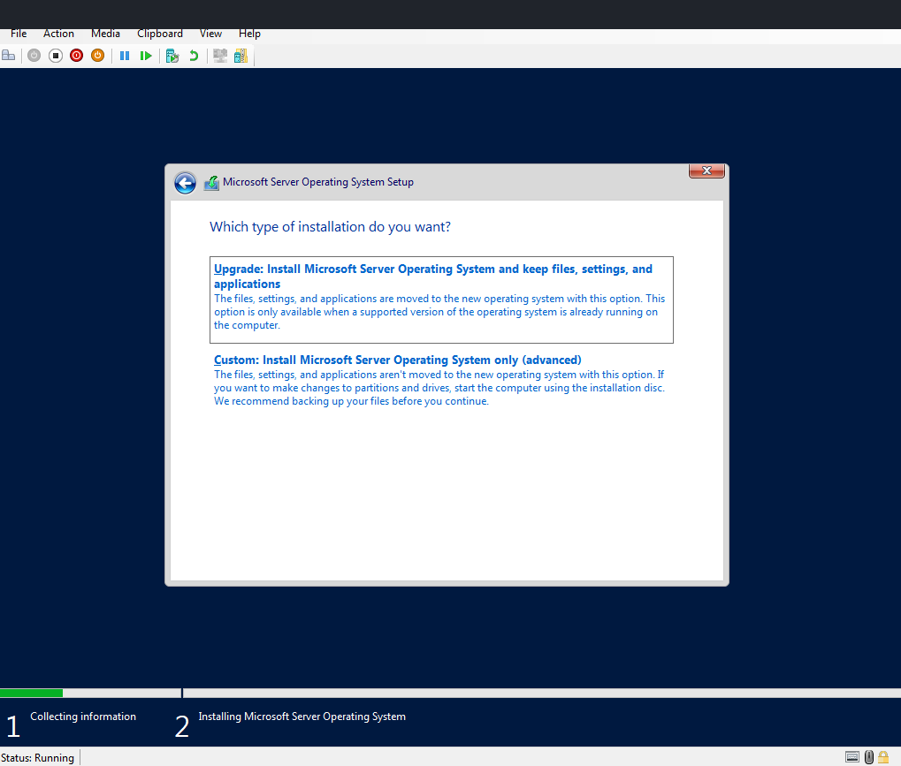

## 018 — Selecting the Windows disk

The installer showed a 100 GB unallocated target disk. I documented the storage available to the guest before the installation continued.

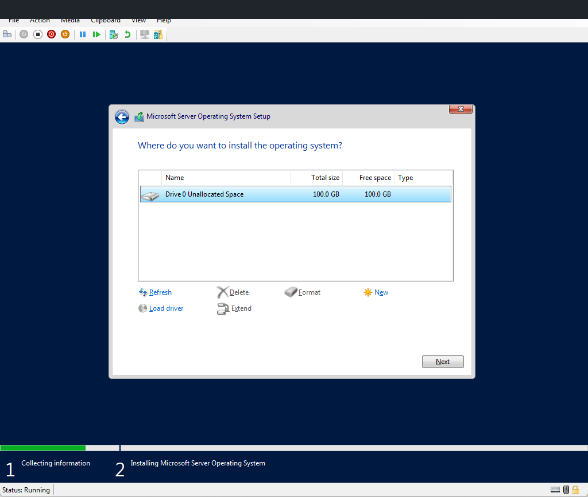

## 019 — Reaching Server Manager

The Windows Server desktop and Server Manager were available after installation. I still had networking to check before treating this VM as usable.

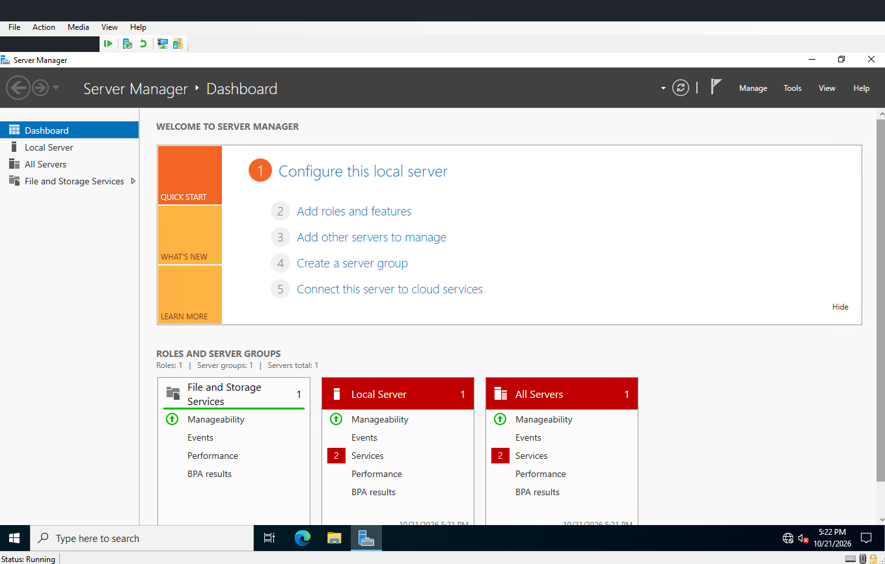

## 020 — Checking the Windows VM identity

I used hostname to confirm which guest I was working in. The machine name is hidden in the published image.

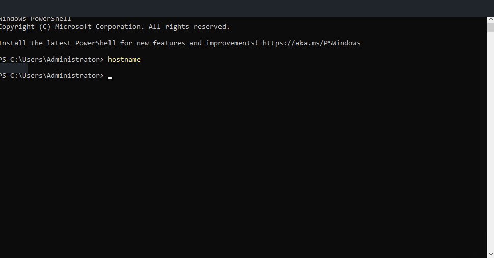

## 021 — Separating link state from reachability

The guest adapter reported Up, but a host-side ping failed and the neighbor entry remained Incomplete. I treated link state and end-to-end reachability as separate checks. The adapter being enabled did not establish a working path between the systems.

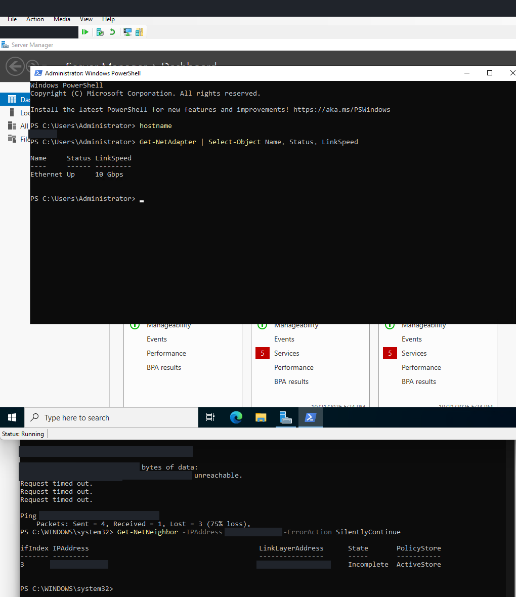

## 022 — Verifying guest network and DNS

I set the guest's DNS server, checked its address, and tested the directory server. The capture shows four successful ping replies and a successful DNS answer for the lab server name.

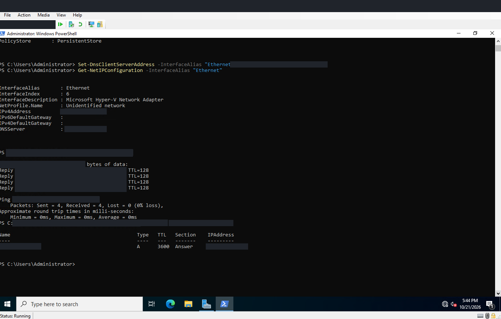

## 023 — Rechecking the host path

A separate host-to-monitoring-VM Test-Connection still failed. I kept this result alongside the successful guest test because they were different paths.

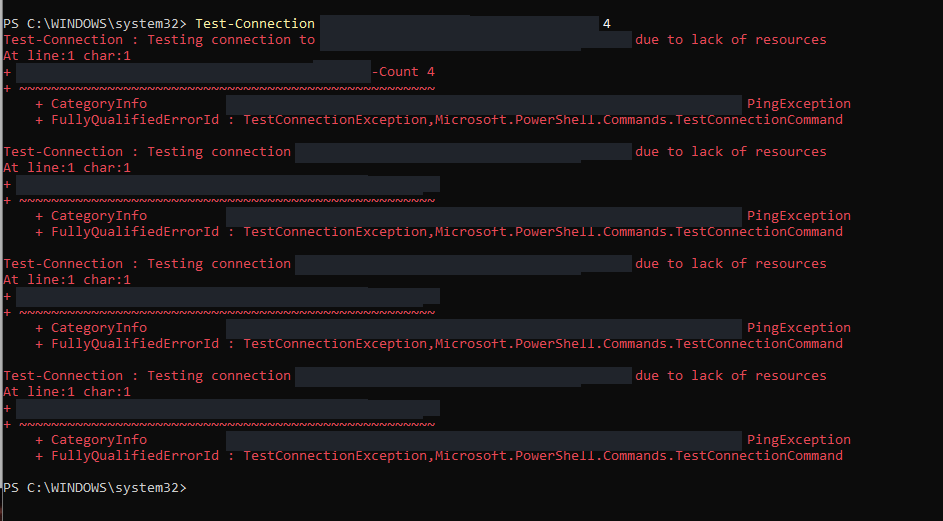

## 024 — Comparing a failing and a working destination

The monitoring VM timed out and its neighbor state was Stale, while the directory server still answered. This narrowed the problem without proving a particular firewall or routing cause.

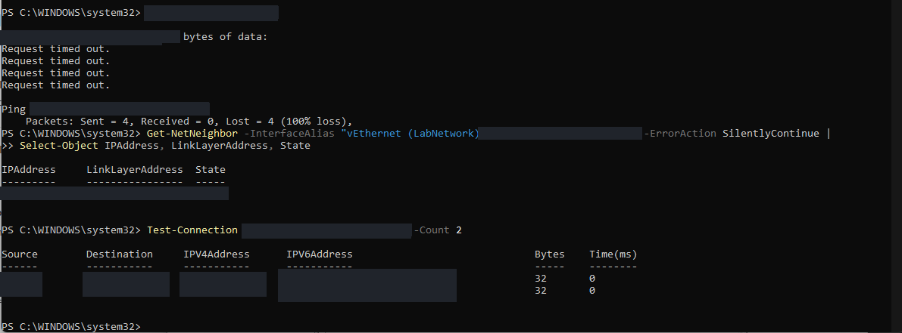

## 025 — Inspecting the default route

I checked the Windows VM's interfaces and routes. Its internet-facing adapter supplied the default route; the lab interface did not have a gateway.

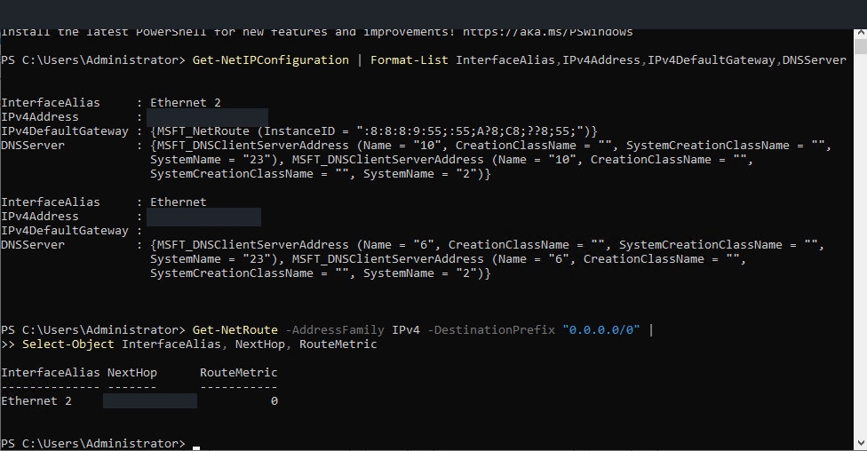

## 026 — Testing internet access and name resolution

A TCP 443 test to a public address succeeded and a Microsoft DNS lookup worked. A lab-name lookup through the default resolver was refused, so internet access and lab DNS resolution needed separate checks.

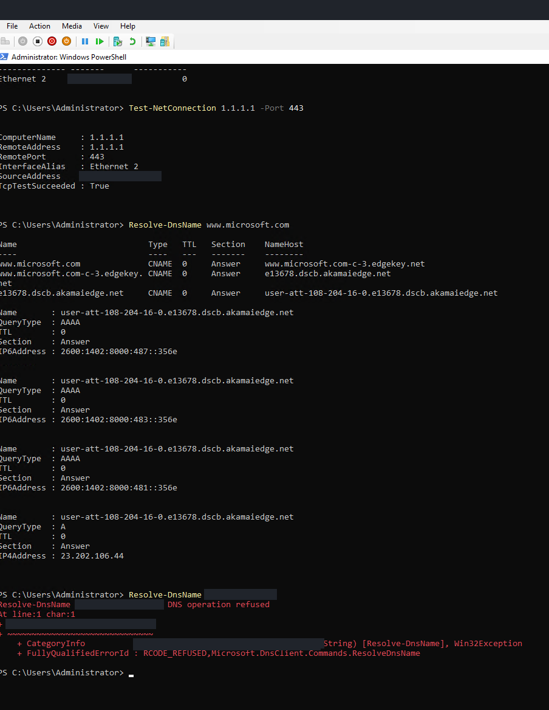
