# Getting Zabbix and its web interface working

[Walkthrough](../README.md) · [Full archive](../archive.md)

I installed Zabbix, the program that checks my computers and reports problems. It needed a database to store information and a website where I could view the results. The website did not work at first, so I worked through the errors until I could open the dashboard.

## 054 — Checking the Zabbix package source

I checked where Ubuntu would download Zabbix from and which version was available. The official Zabbix software source offered version 7.4.16. Zabbix is the tool I used to collect health information and raise alerts.

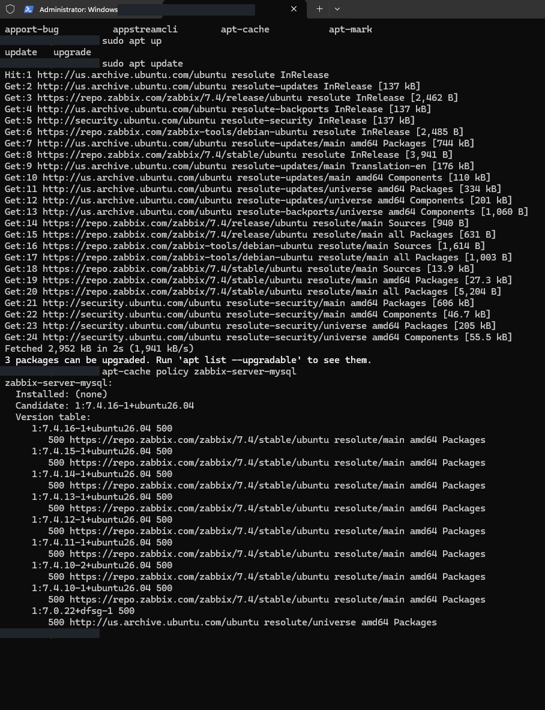

## 055 — Checking MariaDB

I checked that MariaDB was running and set to start automatically. MariaDB is the database that stores Zabbix's information, so it needed to be available before the monitoring application could use it.

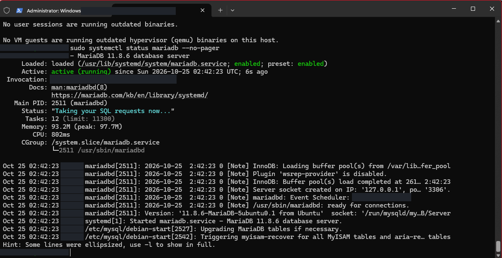

## 056 — Creating a place to store monitoring data

I created a database named zabbix and checked that it appeared in the database list. This gave the monitoring system its own place to store settings and collected information.

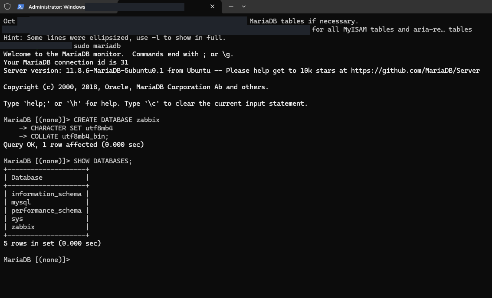

## 057 — Giving the application database access

I checked that the Zabbix database account had permission to use its database. I covered the password-related value that appeared in the original output before sharing this screenshot.

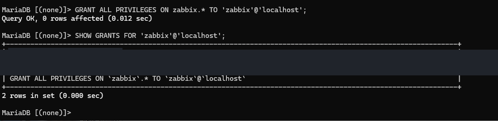

## 058 — Testing database access

I signed in using the Zabbix database account and checked which account and database were active. This confirmed the application account could connect before I loaded the database's structure.

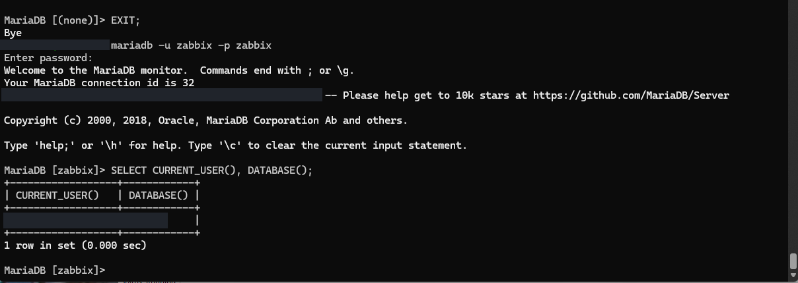

## 059 — Installing the Zabbix components

I checked that the Zabbix server, website components, database setup files, and monitoring agent packages were installed. The list showed version 7.4.16. These components provide different parts of the monitoring system.

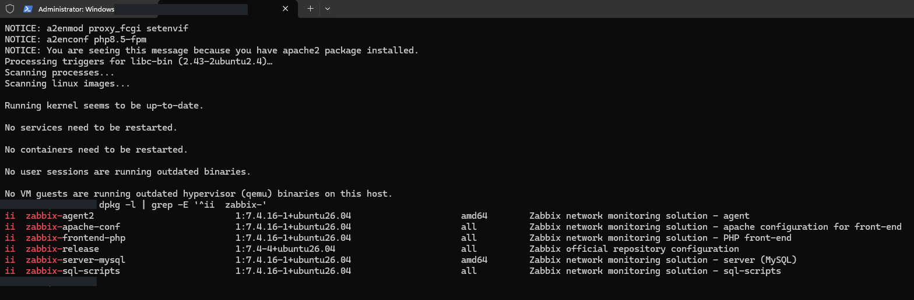

## 060 — Finding the database setup file

I located the file that defines the database structure Zabbix needs. I also checked a database logging setting before importing that file.

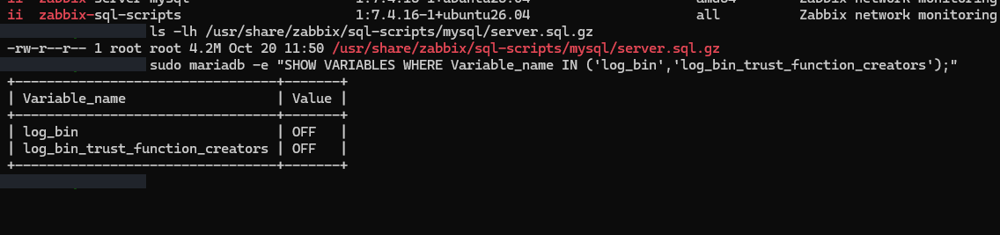

## 061 — Loading the database structure

I loaded Zabbix's database structure and counted 207 tables afterward. Tables organize stored information. The count gave me a concrete check that the database had been populated rather than left empty.

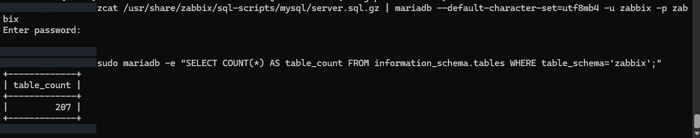

## 062 — Starting the Zabbix server

I checked that the Zabbix background program was running. Its startup setting was still disabled in this screenshot, meaning running now did not guarantee it would start after a reboot. I checked that separately afterward.

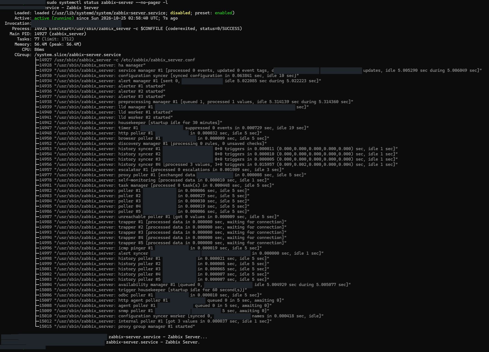

## 063 — Reading the server log

I read Zabbix's startup log instead of relying only on its running status. The log included optional checks that were unsupported and a local monitoring connection that failed, then recovered. I needed to distinguish warnings from problems that stopped the whole system.

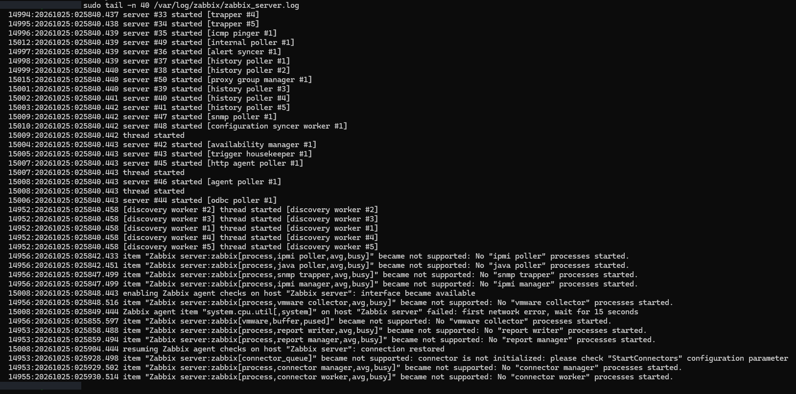

## 064 — Checking startup behavior and Apache

I confirmed that Zabbix was set to start automatically and that Apache was running. Apache serves the website used to view Zabbix. It still showed a server-name warning, which I kept separate from whether the website itself worked.

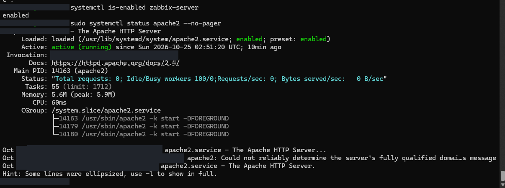

## 065 — Hitting a 404 page

My browser showed a 404 Not Found error when I opened the Zabbix address. The background programs were running, but the web server could not find the page at that path. I needed to check how the website address was configured.

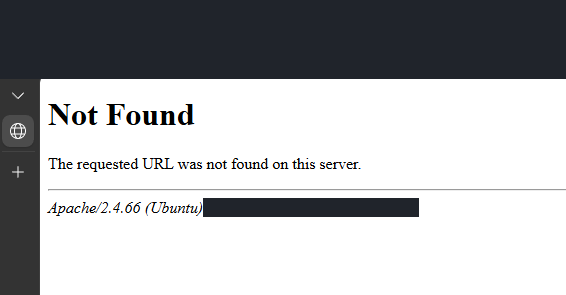

## 066 — Checking where the web address leads

I checked the Apache setting that connects the /zabbix web address to Zabbix's files on disk. This helped me trace where the browser request was being sent.

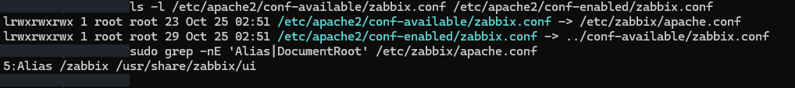

## 067 — Finding a configuration error

Apache's settings check rejected an instruction named ProxyTimeout. I focused on that configuration error before trying the browser again, because the server first needed settings it could accept.

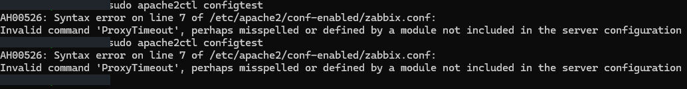

## 068 — Getting a valid Apache configuration

The next Apache check returned Syntax OK, meaning it could read the settings without that blocking error. A server-name warning remained, but it was different from the error I had just addressed.

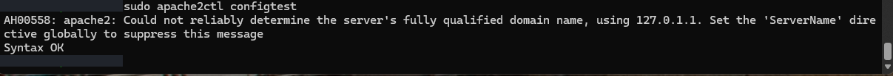

## 069 — Finding PHP source in the browser

The browser now displayed PHP program code instead of the Zabbix page. That meant it could reach the file, but the code was not being processed into a usable webpage. I checked the connection between Apache and PHP next.

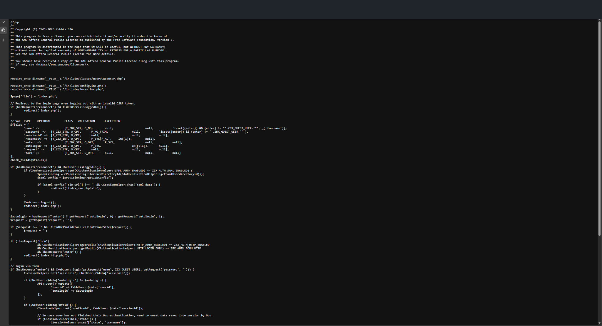

## 070 — Connecting the web server to PHP

I enabled the Apache components needed to pass requests to PHP-FPM, the program that runs PHP code. I checked that PHP-FPM was running and that Apache accepted the updated settings.

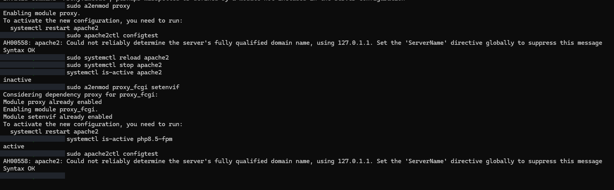

## 071 — Enabling PHP processing

I enabled Apache's PHP-FPM configuration and checked it again. This was part of connecting the web server to the program that would build the Zabbix pages.

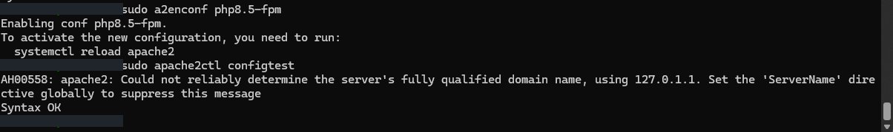

## 072 — Checking how page requests are handled

I checked the setting that tells Apache where to send PHP requests. It pointed to PHP-FPM through a local connection on the Ubuntu machine. I wanted to verify that the handoff was configured, not just that both programs were running.

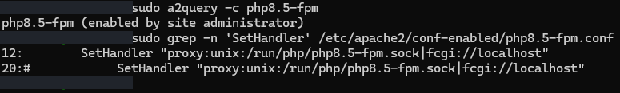

## 073 — Checking that the server returns a webpage

I started Apache and requested the Zabbix page directly from Ubuntu. The response contained webpage content, called HTML. The next browser check reached the setup screen, providing a clearer confirmation that the page worked.

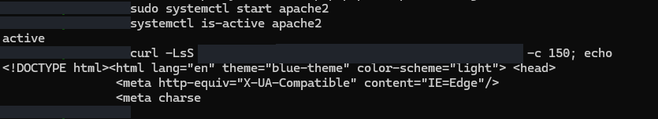

## 074 — Reaching the Zabbix installer

The Zabbix setup page finally opened in the browser. This was the visible result of working through the missing page, Apache settings, and PHP processing problems.

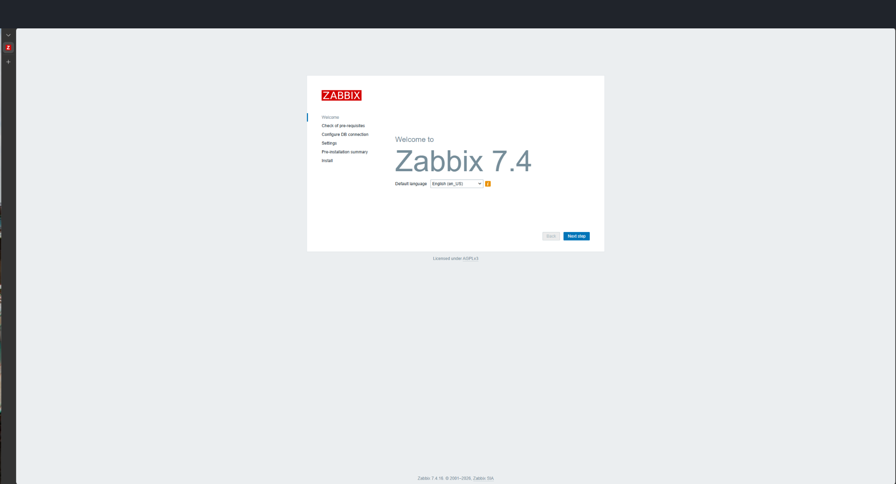

## 075 — Checking what the website needs

I reviewed the setup program's checks for PHP and the settings Zabbix needed. The visible checks passed, so I could continue with the website installation.

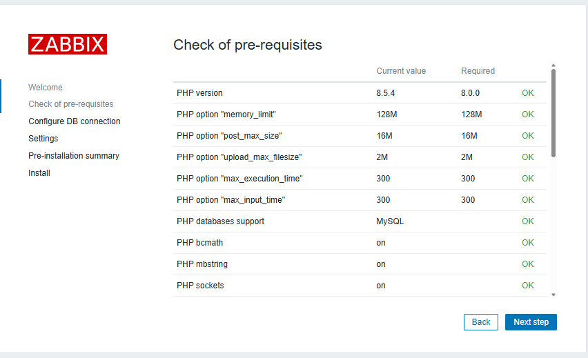

## 076 — Entering the database connection

I reached the screen that connects the Zabbix website to its database. The database was on the same machine, which is what localhost means. The password field was blank in this intermediate screenshot.

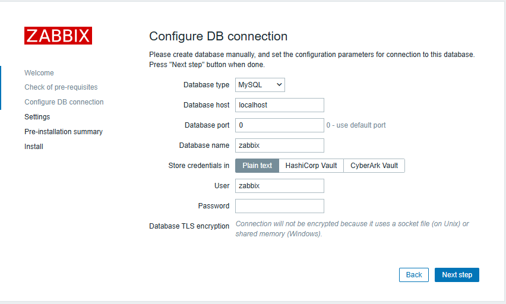

## 077 — Reviewing website settings

I reviewed the website settings. The time zone was still set to UTC, a common reference time used when comparing systems in different locations.

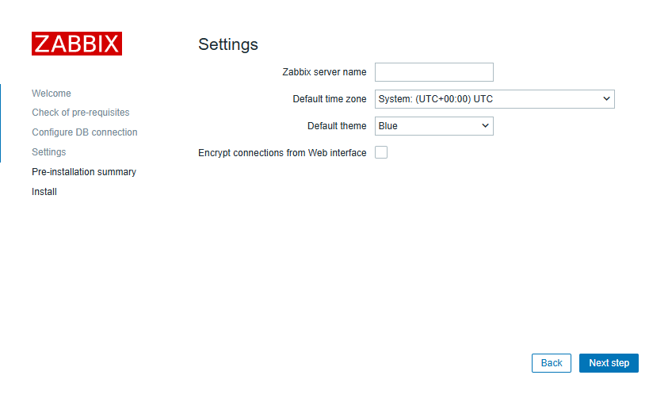

## 078 — Setting the display time zone

I changed the Zabbix website's display time zone to America/New_York. I needed to remember that choice later when comparing its alert times with Windows logs displayed in another time zone.

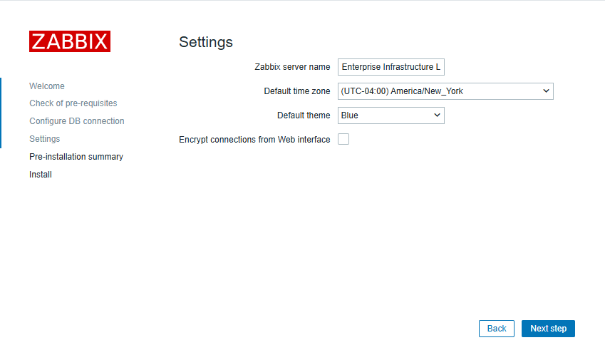

## 079 — Reviewing the installation summary

I reviewed the installation summary before finishing. It also showed that encryption was not configured for the database connection or website. I kept this limitation visible because this was a practice lab.

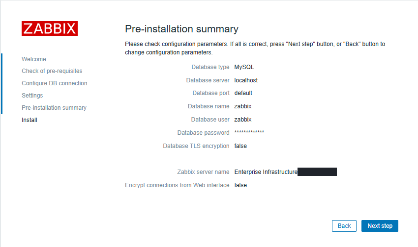

## 080 — Completing the website installation

Zabbix reported that its website had installed successfully. I could now move on to signing in and checking the monitoring dashboard.

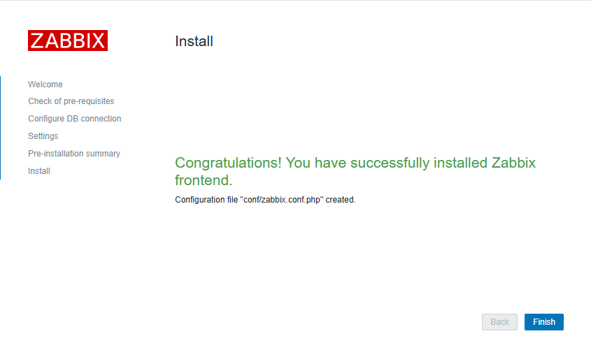

## 081 — Encountering a login error

My first login attempt failed. The screenshot shows the error but does not prove why it happened, so I did not label it as a password mistake or another specific cause.

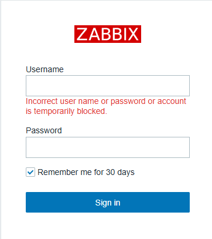

## 082 — Opening the working dashboard

I reached the working Zabbix dashboard and confirmed the server was running. At this stage, it was checking its own machine; I had not yet added Windows monitoring. The map shown is a default dashboard feature, not my lab's network layout.

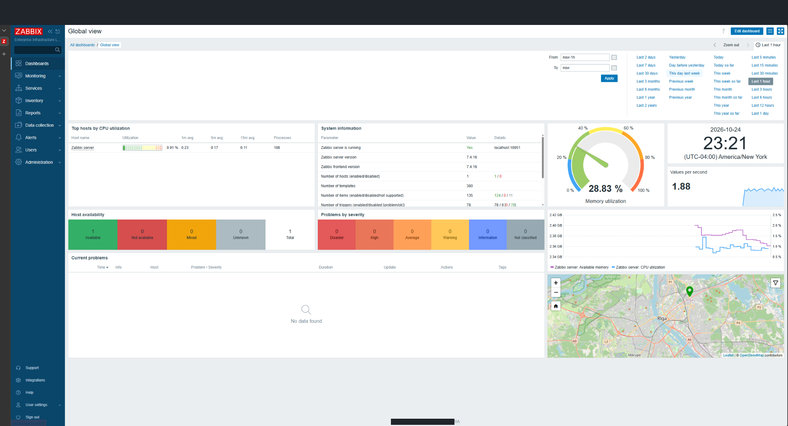
