# Bringing Windows into monitoring

[Walkthrough](../README.md) · [Full archive](../archive.md)

Once Zabbix could monitor itself, I installed Agent 2 on the Windows directory server. I checked the Windows service and listening port, added the passive agent interface in Zabbix, and inspected real collected values. I also captured unavailable and available states and a deliberate service-stop test. The file numbers alone are not a stopwatch for that test.

## 083 — Getting Windows Agent 2

I opened the official Zabbix download page for the Windows Agent 2 7.4.16 installer.

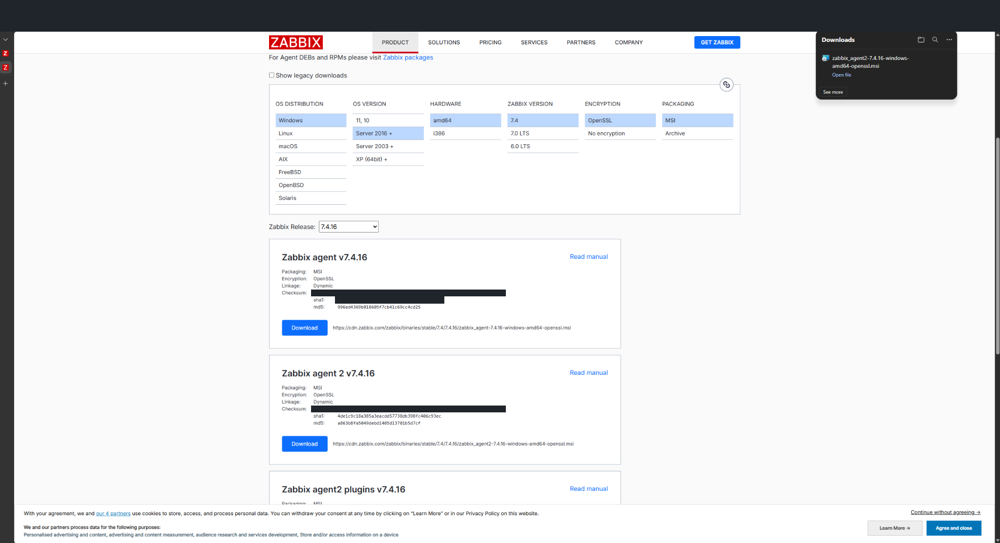

## 084 — Preparing to transfer the installer

I checked the downloaded MSI and the VM's Guest Service Interface. The integration service was initially disabled.

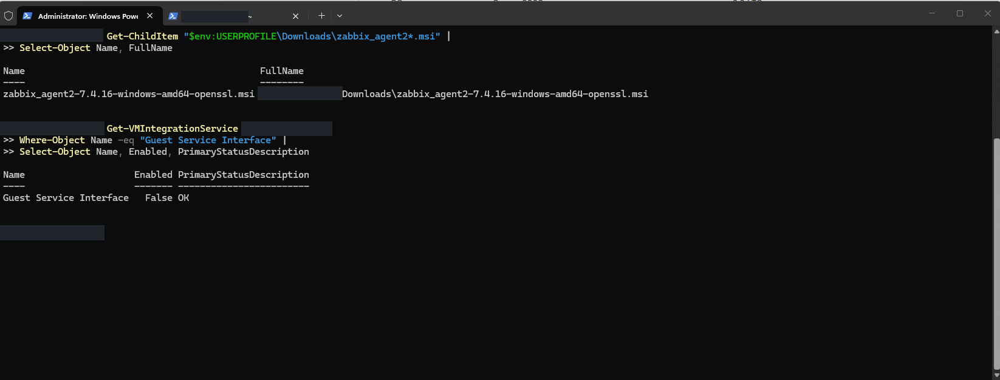

## 085 — Enabling guest file-transfer support

I enabled the Guest Service Interface and verified it changed from False to True. This prepared the guest integration feature used during installer transfer.

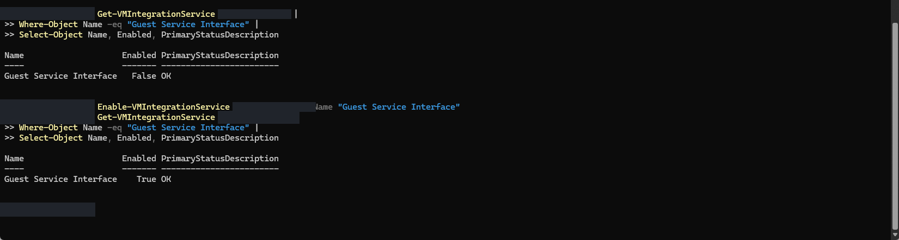

## 086 — Confirming the installer reached Windows Server

I checked the installer directory inside the Windows Server 2022 evaluation guest and confirmed the Agent 2 MSI was present.

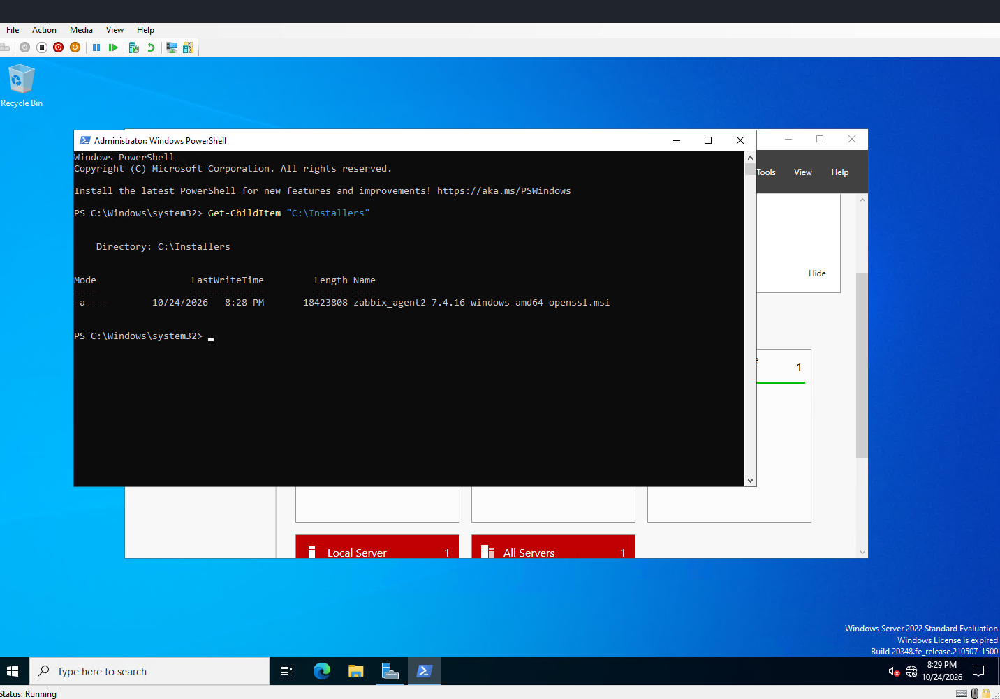

## 087 — Launching Agent 2 setup

I opened the Windows Agent 2 installer inside the server VM.

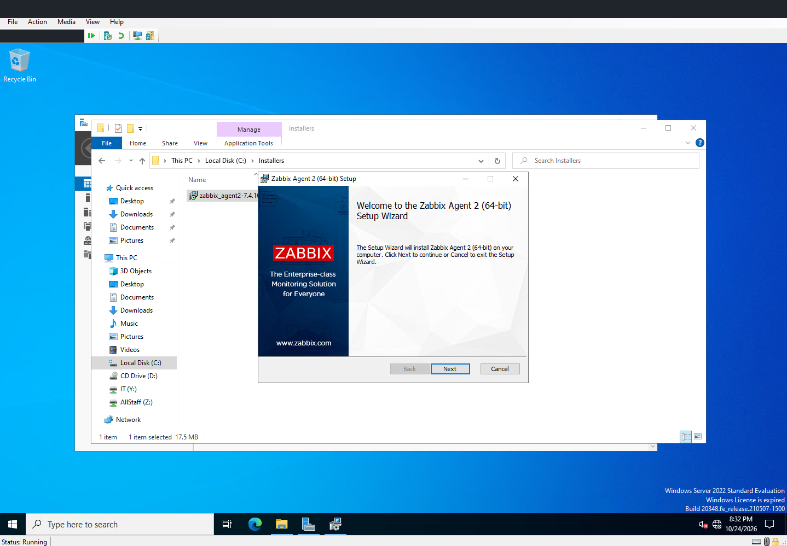

## 088 — Reviewing Agent 2 components

I reviewed the installer components, including the agent daemon, sender, and get utility.

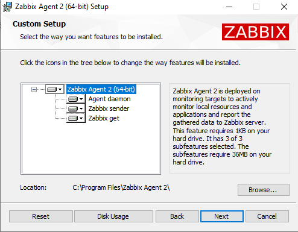

## 089 — Configuring the agent connection

I entered the monitoring server as the allowed Zabbix server and used listen port 10050. The active-check field still showed loopback and PSK was unchecked; the monitoring demonstrated later uses the passive agent interface.

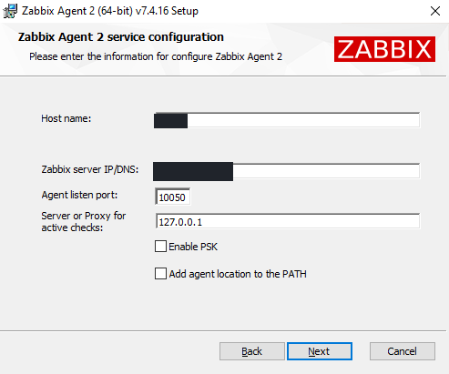

## 090 — Installing the Windows agent

I reached the final installation screen after reviewing the Agent 2 settings.

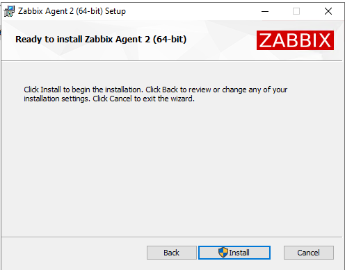

## 091 — Verifying the Windows service

I queried the service and confirmed Zabbix Agent 2 was Running with Automatic startup.

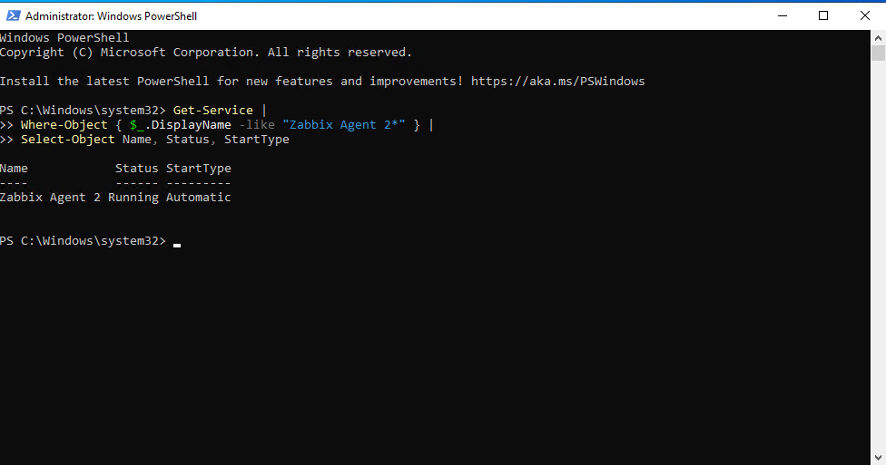

## 092 — Checking port 10050

I checked the service again and confirmed a listening TCP endpoint on port 10050. This separated local agent readiness from connectivity in the Zabbix frontend.

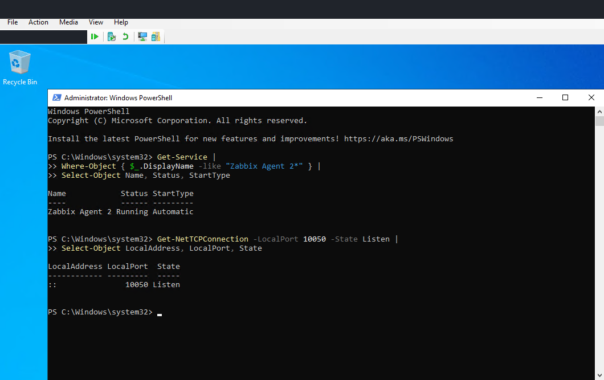

## 093 — Creating the monitored host

I added the Windows host to Zabbix with the Windows by Zabbix agent template and the Windows servers group.

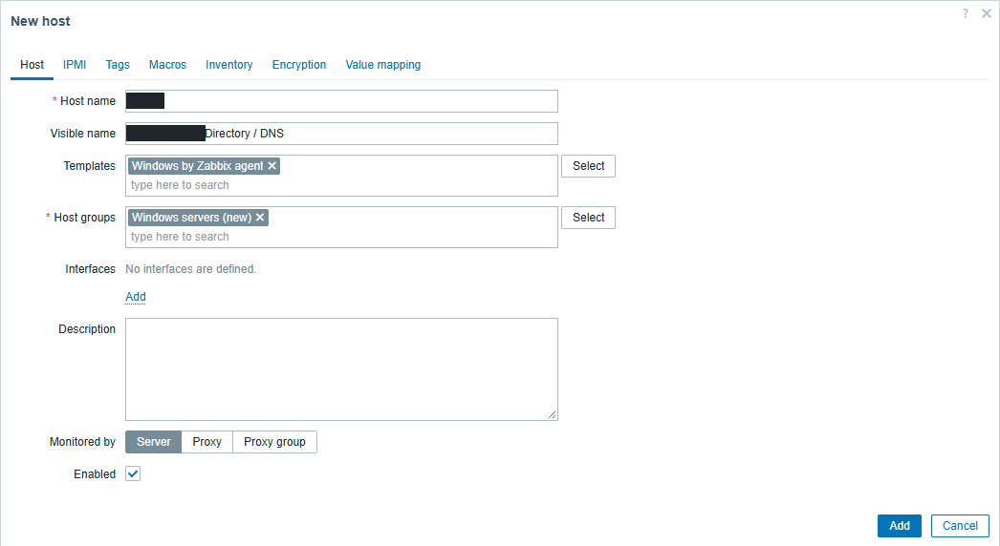

## 094 — Adding its agent interface

I configured the server's agent interface on port 10050 and described its directory-services and DNS role. The real address and machine name are redacted.

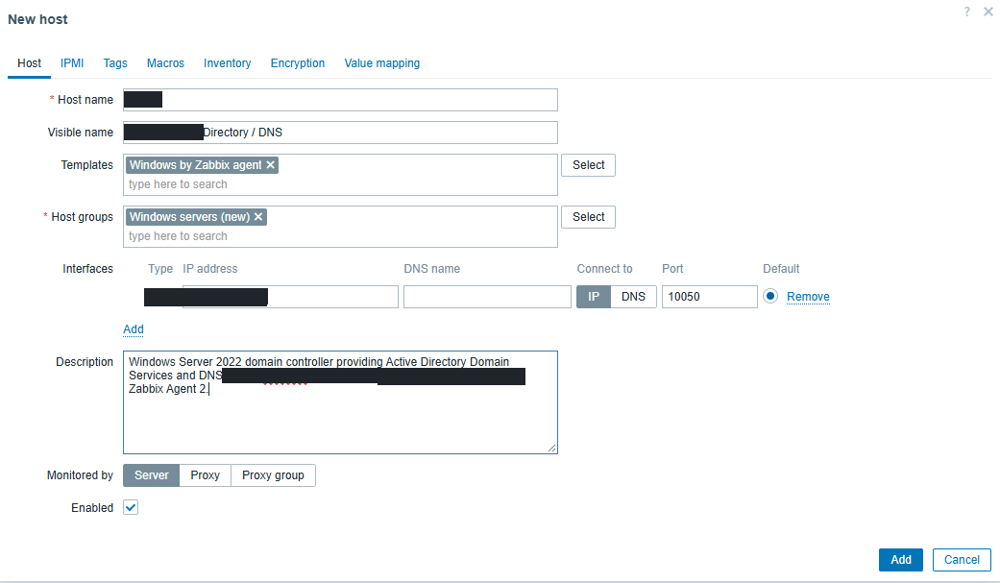

## 095 — Seeing the host become available

The host list showed both the Windows agent and the Zabbix server enabled with green ZBX availability.

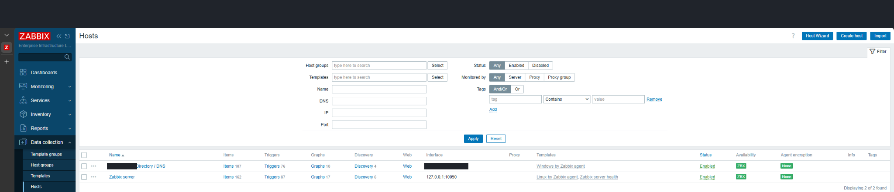

## 096 — Inspecting collected data

I opened Latest data and reviewed CPU, disk, memory, and Windows service items. This checked that the host was producing data, beyond simply appearing in the inventory.

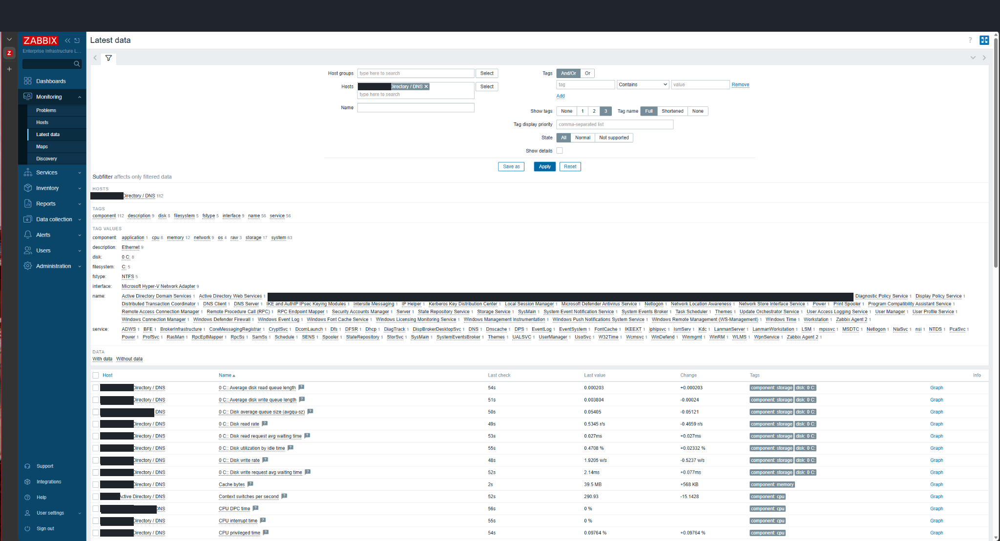

## 097 — Checking DNS service states

I filtered the collected items for DNS. Both DNS Server and DNS Client showed Running (0) in the captured values.

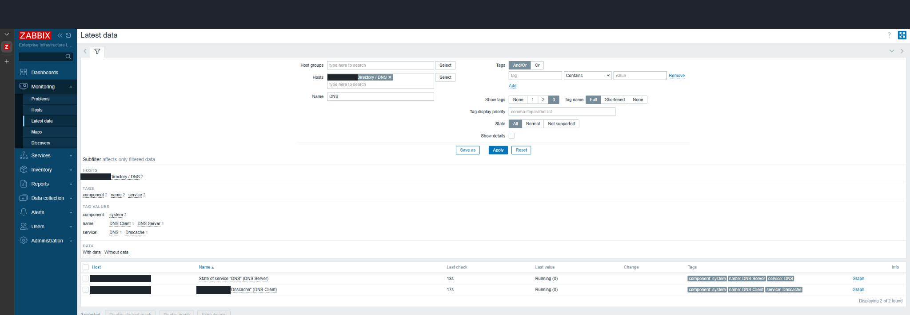

## 098 — Reviewing DNS triggers

I inspected the discovered DNS service triggers and their expressions. They were enabled and in an OK state at this point.

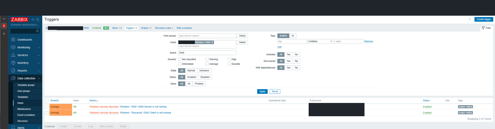

## 099 — Reviewing agent triggers

I compared the agent service-state trigger with the agent-availability trigger. These are different checks: one reads a service state, while the other reports whether Zabbix can reach the agent.

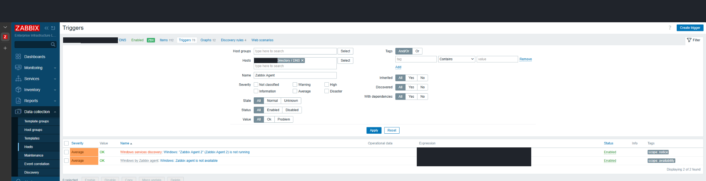

## 100 — Capturing unavailable status

The Windows host's ZBX indicator was red in this capture. This records an unavailable monitoring interface, not proof that directory services or DNS had stopped.

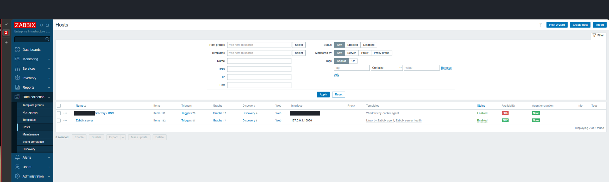

## 101 — Capturing available status

Another host-list capture shows the Windows ZBX indicator green again. I retained both states without using file order alone as a precise event timeline.

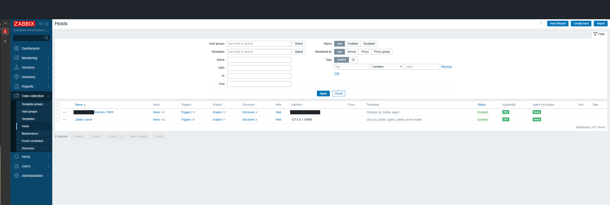

## 102 — Stopping the agent for a test

I deliberately stopped Zabbix Agent 2 and confirmed Stopped with Automatic startup still configured. This demonstrates a service-stop test, but the screenshot has no timestamp tying it to the later October 30 event.

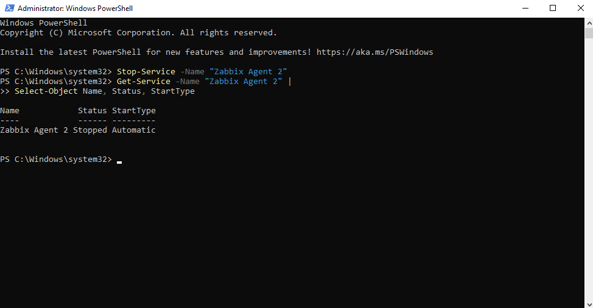

## 103 — Reviewing a restart warning

Zabbix showed a host-restarted warning based on uptime. I treated this as a separate signal from agent availability.

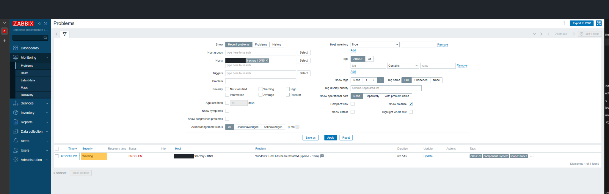

## 104 — Reviewing host problem counts

I checked the host list, availability, and problem counts to see how the conditions appeared from the monitoring side.

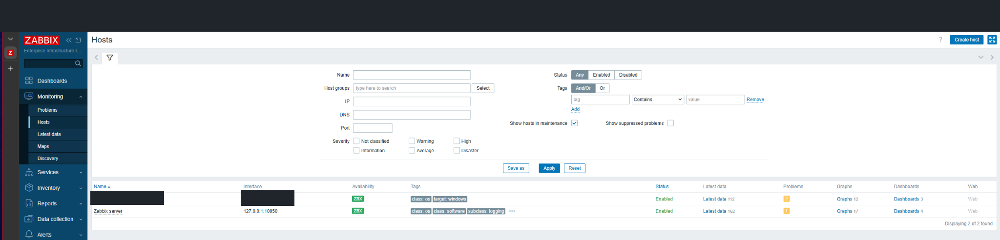
