# Working through the time-sync warning

[Walkthrough](../README.md) · [Full archive](../archive.md)

Zabbix warned me that the computers disagreed about the time. That matters because comparing logs is difficult when their clocks do not match. I checked where each computer got its time, corrected the Linux clock, and checked that Windows eventually used the Linux server as its time source.

## 105 — Finding a time warning

On October 28, Zabbix showed a clock disagreement, a restart warning, and a monitoring interruption that had already cleared after two minutes. I kept this separate from the five-minute event recorded on October 30.

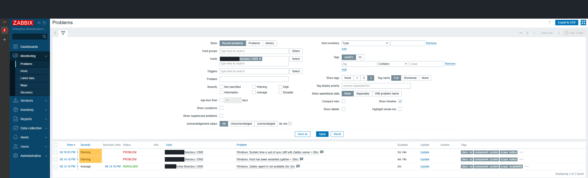

## 106 — Checking Windows time

I checked Windows' clock and the service responsible for keeping its time accurate. It was using the virtual-machine time provider and reported that it was not synchronized. Its displayed time zone was seven hours behind UTC.

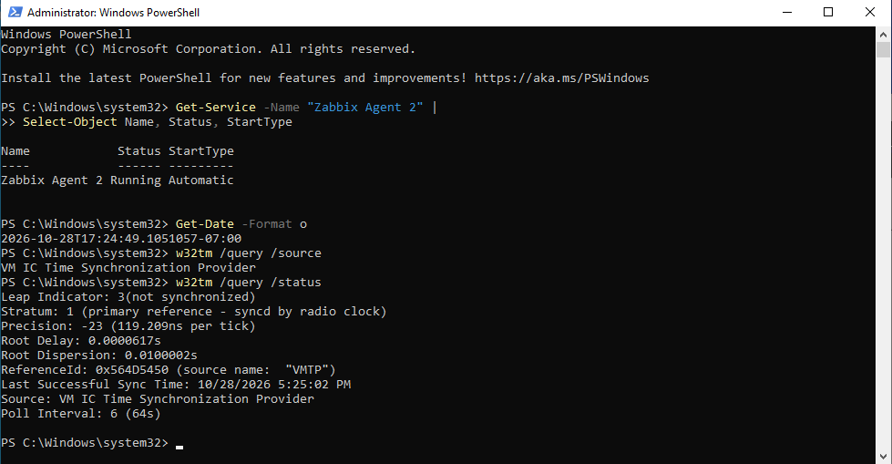

## 107 — Checking Linux time

I checked Ubuntu's clock too. Its automatic time service was on, but the system still said the clock was not synchronized. Having the service enabled was not enough to prove the time was correct.

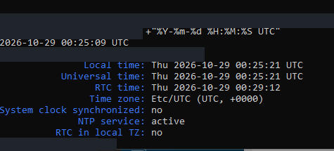

## 108 — Checking the server responsible for domain time

I checked which Windows server held the domain's main management roles, including the role relevant to domain timekeeping. All five roles were listed on this directory server. I also encountered a command-writing error during these checks.

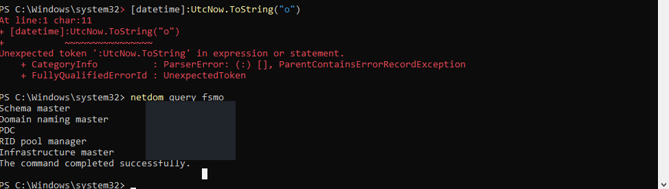

## 109 — Capturing Windows UTC time

I corrected the command and displayed Windows time in UTC. Using one shared time reference made it easier to compare results from computers whose screens used different time zones.

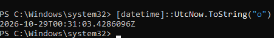

## 110 — Measuring how far the clock was behind

Chrony, Ubuntu's timekeeping program, reported that the clock was about 221.5 seconds slow—roughly three minutes and 42 seconds. This gave me a measurable explanation for the clock warning.

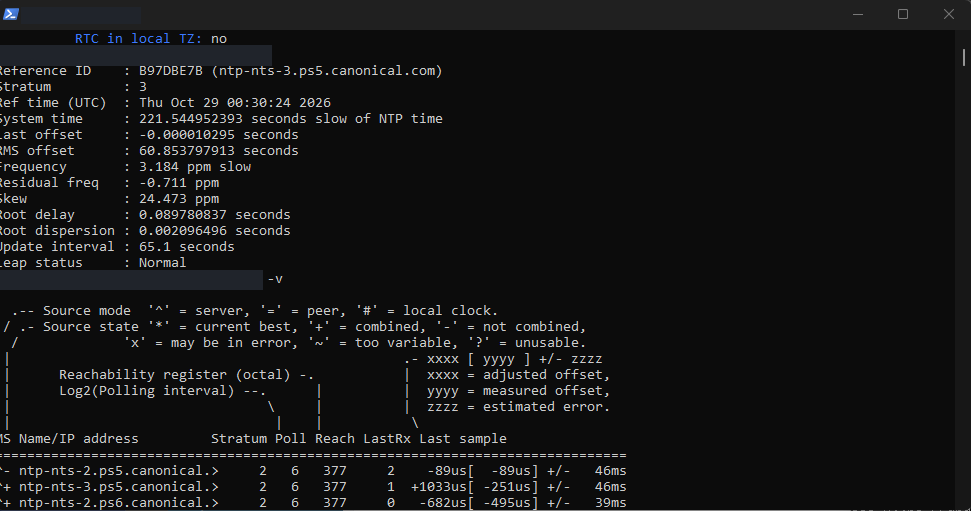

## 111 — Inspecting Chrony's sources

I checked the external time sources Chrony could use and which one it had selected. Before adjusting the clock, I wanted to know where the reference time was coming from.

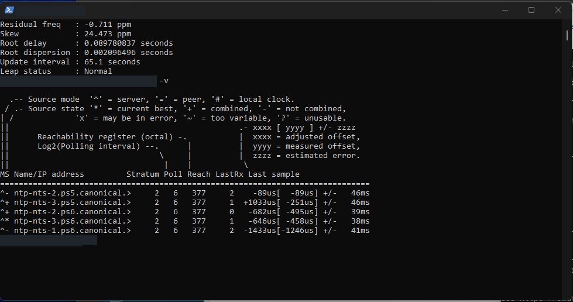

## 112 — Correcting the Linux clock

I told Chrony to correct the clock immediately and received a successful response. Its next reading showed no remaining difference, but another status screen had not yet updated to synchronized. I checked again afterward.

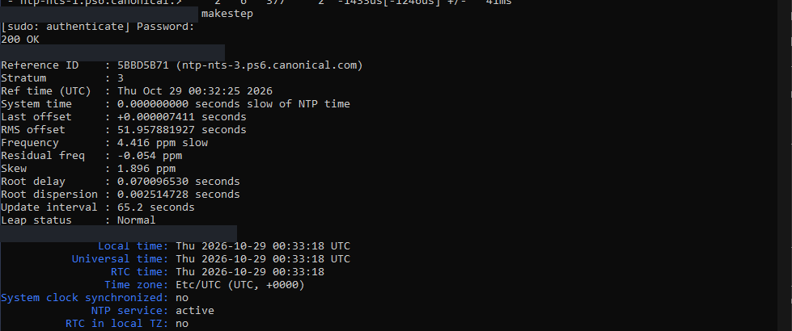

## 113 — Verifying Linux synchronization

A later check confirmed Ubuntu's clock was synchronized. I also reviewed the timekeeping settings so I could see how Chrony was configured to keep the time accurate.

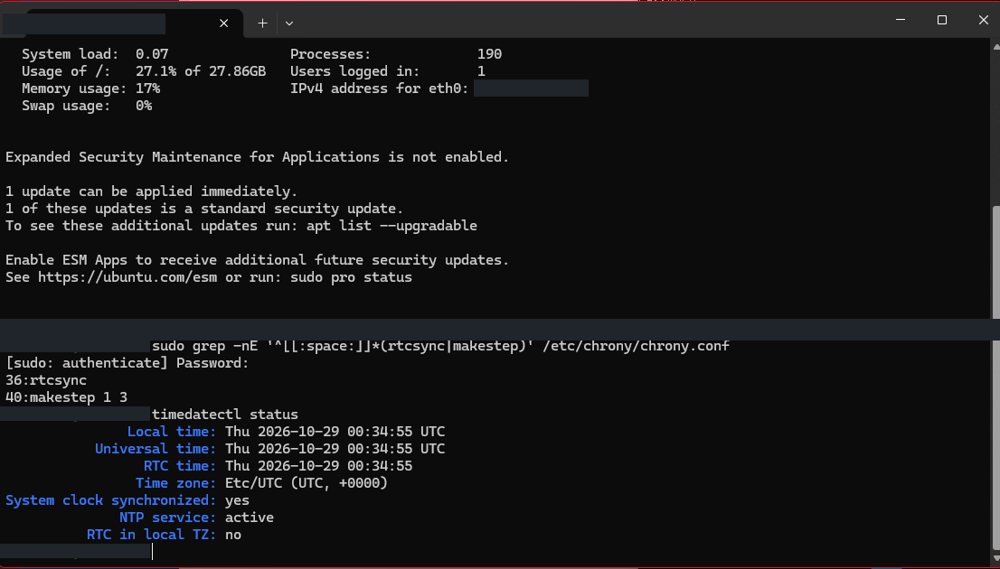

## 114 — Finding denied NTP access

I found that Chrony was refusing time requests from the Windows server. Ubuntu's UFW firewall was inactive, so I checked Chrony's own access rules. The timekeeping program itself was denying the request.

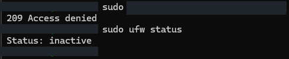

## 115 — Allowing the Windows NTP client

I changed Chrony's settings to allow the Windows server, restarted it, and repeated the access check. The result now said Access allowed. This addressed the permission problem I had just identified.

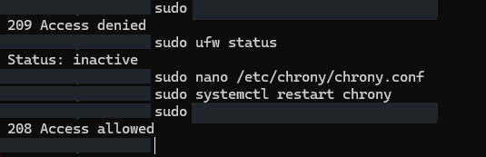

## 116 — Checking that the time service answers requests

I checked that the time service was accepting requests on UDP port 123, the standard NTP port. NTP is the protocol computers use to exchange time information. Chrony's reported clock difference was now roughly half a millisecond.

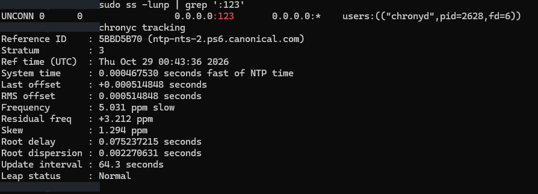

## 117 — Testing time from Windows

I requested five time samples from Ubuntu using Windows. The replies showed the two clocks were still about 3.7 seconds apart at that point. This checked the time relationship from the Windows side.

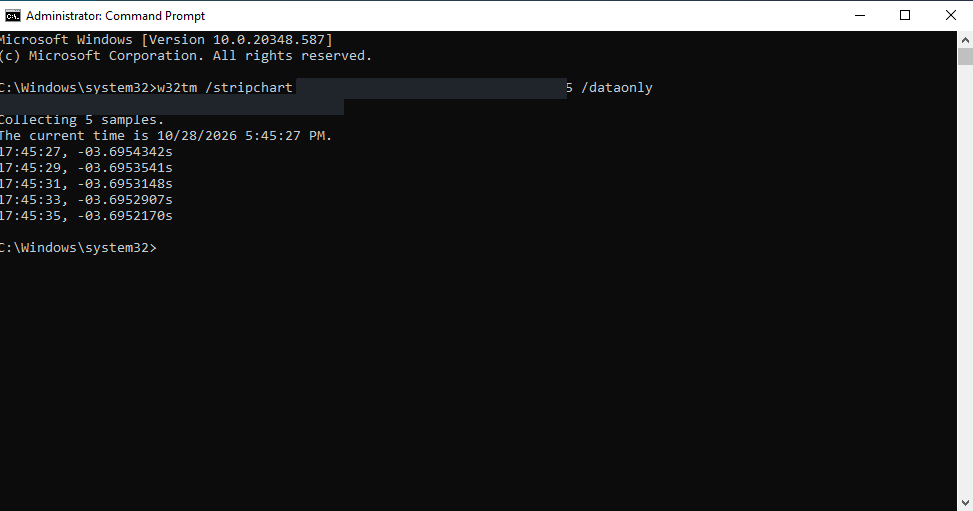

## 118 — Telling Windows where to get the time

I told Windows to use the Linux time server and asked it to synchronize. The commands completed, but Windows still reported its old virtual-machine time source and no synchronization. I needed to check the actual result, not just the command's success message.

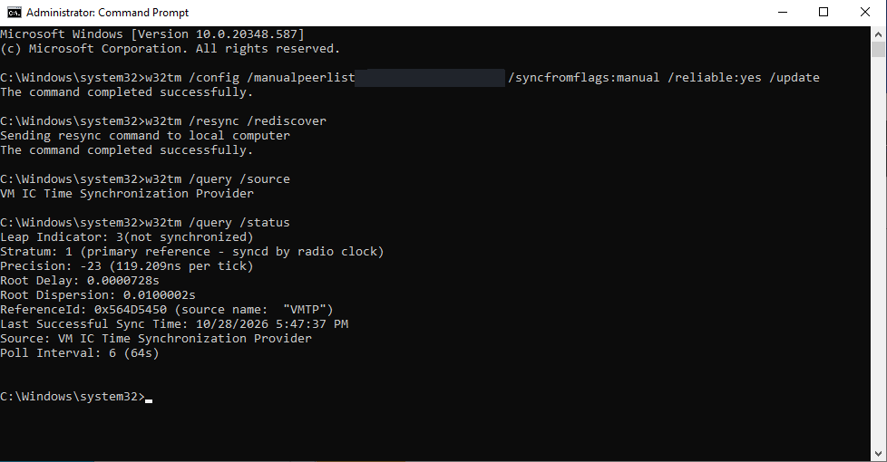

## 119 — Inspecting time-service configuration

I reviewed Windows' time settings to see both the configured server and the available time providers. The virtual-machine time provider was still enabled in this screenshot.

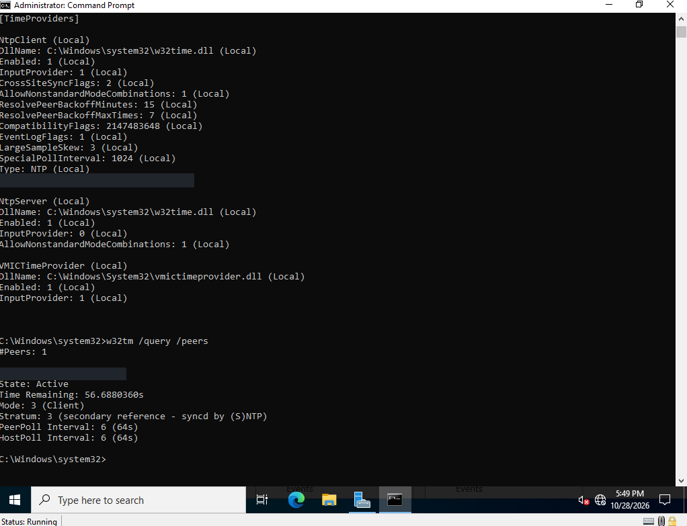

## 120 — Checking the actual source again

I checked the source Windows was actually using, and it still showed the virtual-machine provider. Changing a setting had not yet produced the result I wanted.

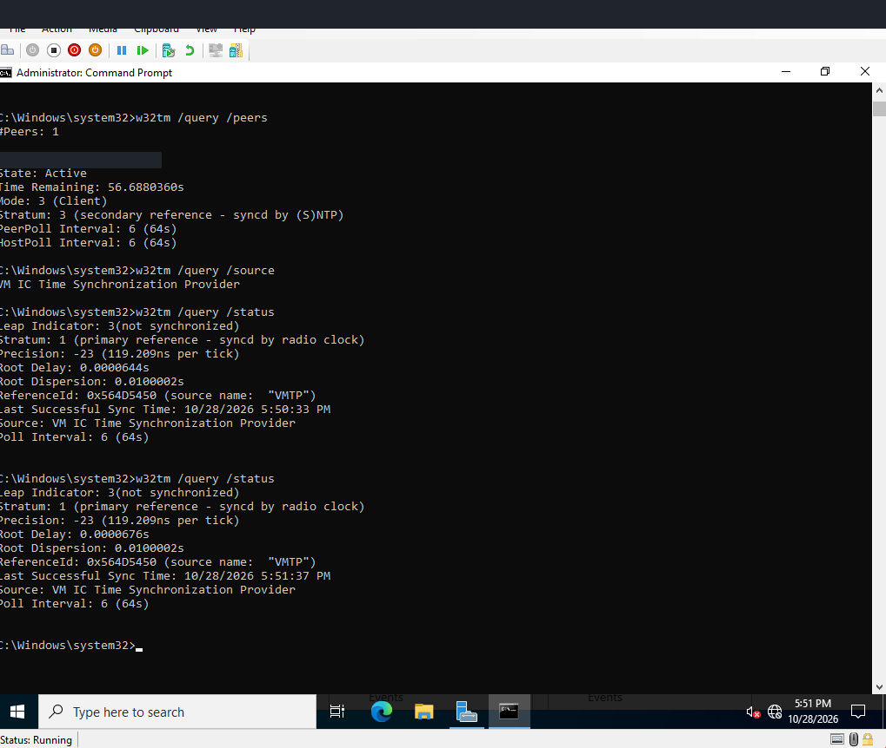

## 121 — Confirming Windows synchronization

The final Windows status showed successful synchronization and identified the Linux server as its time source. I did not capture every change between the earlier checks and this result, so I cannot point to one specific command as the proven fix.

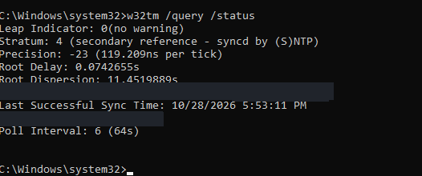

## 122 — Checking the current problem view

The filtered Zabbix page showed no current problems. Because filters can hide other results, I checked the problem history next rather than assuming that this one empty screen proved everything was healthy.

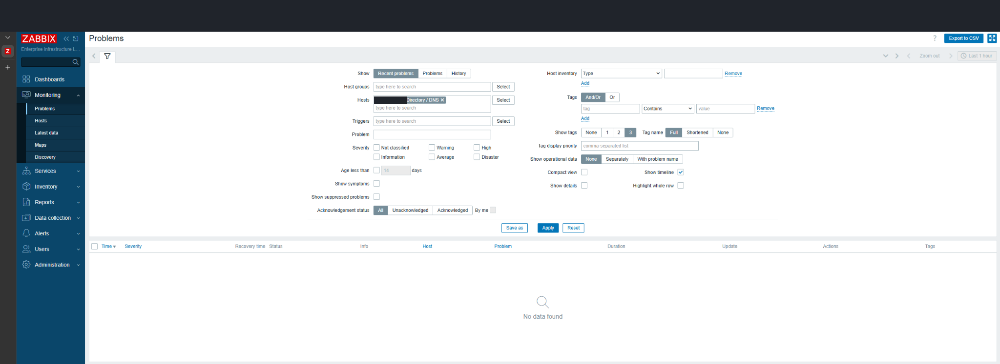

## 123 — Checking resolved history

The history showed the earlier clock, restart, and monitoring-connection warnings had cleared. The clock warning had been open for 17 minutes and three seconds. That is how long Zabbix recorded the problem, not a general promise about how quickly I can fix one.

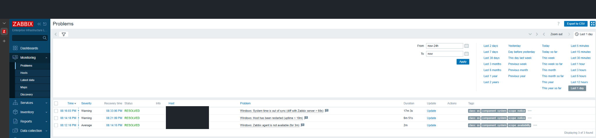
