# Closing the loop with alerts and investigation

[Walkthrough](../README.md) · [Full archive](../archive.md)

I wanted an email when monitoring lost contact with Windows and another when it recovered. After setting that up, I investigated the October 30 interruption by comparing the alerts with Windows' own records. I found useful evidence about startup and recovery, but not enough to prove exactly what caused the interruption.

## 124 — Opening the email settings

I opened Zabbix's email settings. The form initially contained generic examples for a mail server; it did not yet show my completed Gmail setup.

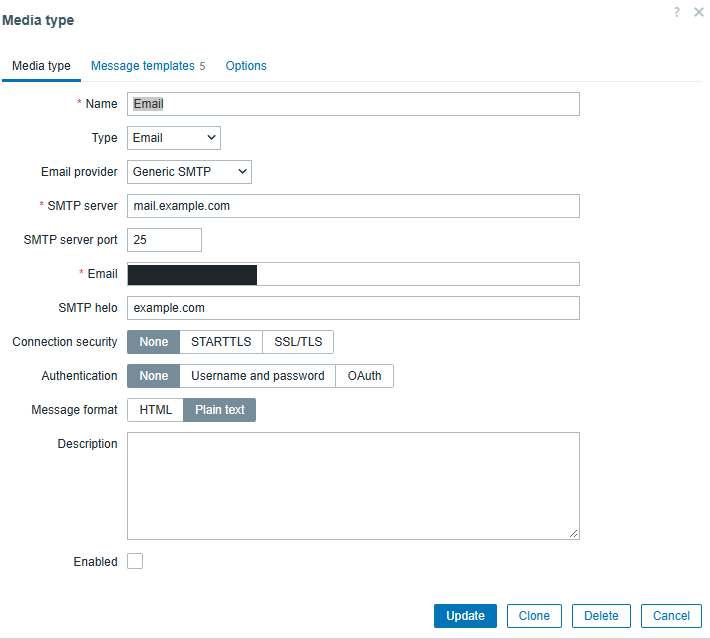

## 125 — Preparing app-password access

I opened Google's page for creating an app password, which is a separate password for an application to use. This screenshot does not show a generated password, and I did not include one in the repository.

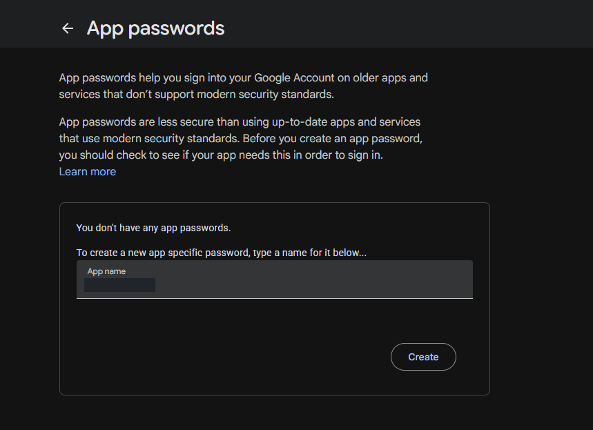

## 126 — Connecting the browser through SSH

I opened an SSH tunnel, a connection that lets my local browser reach a web service through the remote-login connection. I used local port 8080 to reach the monitoring server's web service on port 80.

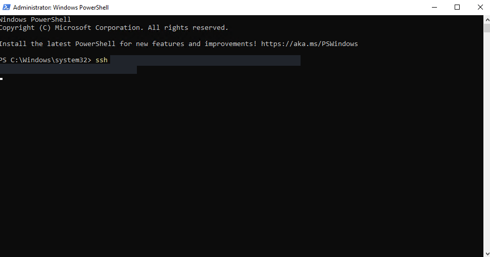

## 127 — Using the tunneled login page

I reached the Zabbix login page through the tunnel. The address 127.0.0.1 means this computer, so the browser was using the local end of the tunnel rather than directly showing the server's lab address.

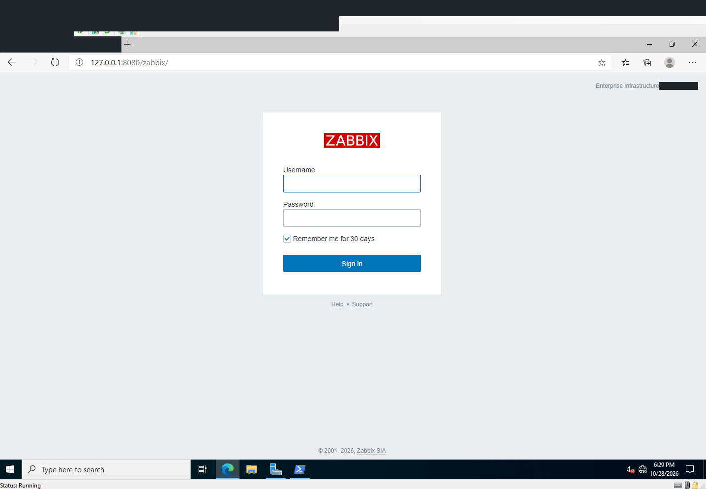

## 128 — Selecting Gmail as the provider

I selected Gmail as the email provider in Zabbix. The screenshot shows the setup choice with blank credential fields, not a password someone else could reuse.

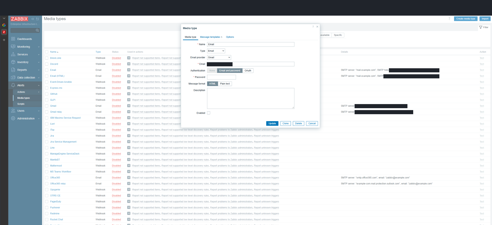

## 129 — Testing the Gmail connection

I sent a test through Zabbix's Gmail connection and the test reported success. I checked this first so I could separate email-setup problems from problems in the automatic alert rule.

## 130 — Choosing who receives alerts

I enabled email delivery for the chosen recipient at every severity level and at all times. This meant the recipient's schedule would not prevent this demonstration's alerts from being sent. I covered the email address.

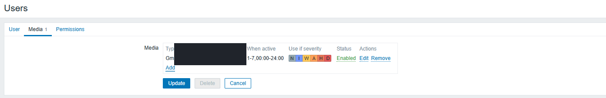

## 131 — Choosing when to send an alert

I limited the alert rule to two conditions: the selected Windows server and its unavailable monitoring agent. Both had to match. This kept the email action focused on the specific problem I wanted to demonstrate.

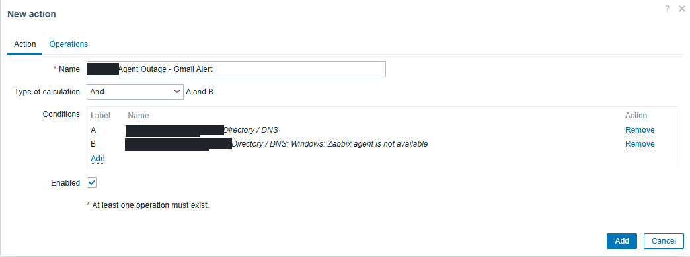

## 132 — Adding the problem notification

I configured Zabbix to send a Gmail message to the chosen user when that alert action ran. The Immediately option means no extra delay was configured for that step; it does not mean Zabbix detects every failure instantly.

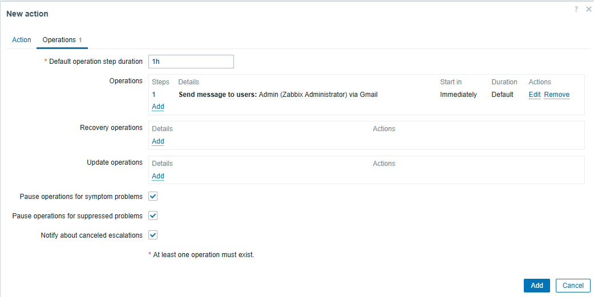

## 133 — Adding recovery notification

I added a second message for when the problem cleared. I wanted the person receiving the first alert to also know when monitoring had recovered.

## 134 — Confirming the action was enabled

Zabbix confirmed that the alert action had been added, and the list showed it enabled. I then had both the problem message and recovery message configured for the demonstration.

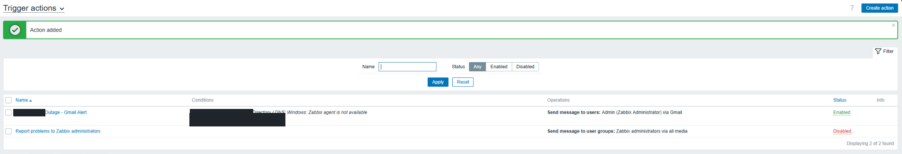

## 135 — Running into service permissions

I tried to start the Windows agent without administrator permissions, and the command failed. The agent was shown as stopped in this capture. This error explained why that command failed, but not what originally caused the monitoring interruption.

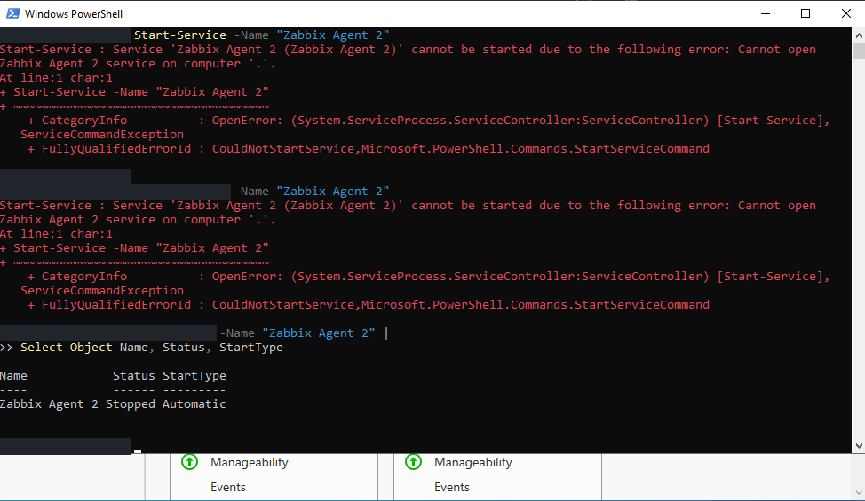

## 136 — Checking again as an administrator

I checked again in an administrator window. The agent was already running before the start command shown below it, so I could not honestly claim that this command brought it back.

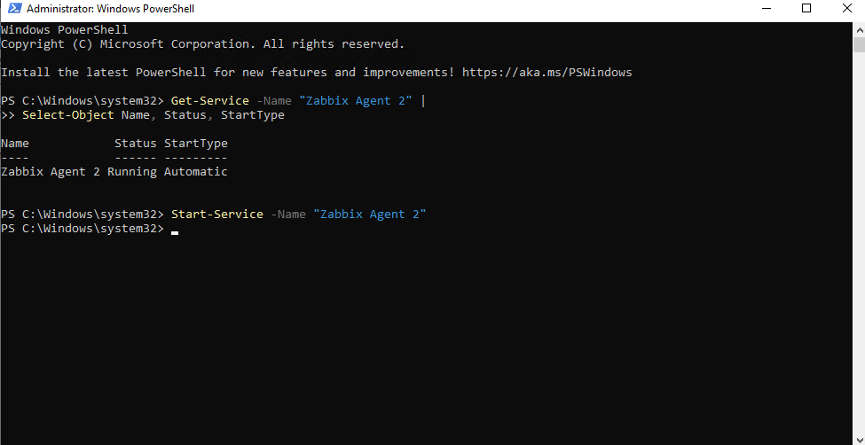

## 137 — Checking availability during the interruption

Zabbix showed the Windows monitoring agent as unavailable. I used the detailed problem and email records that followed to check the event times instead of relying only on this red indicator.

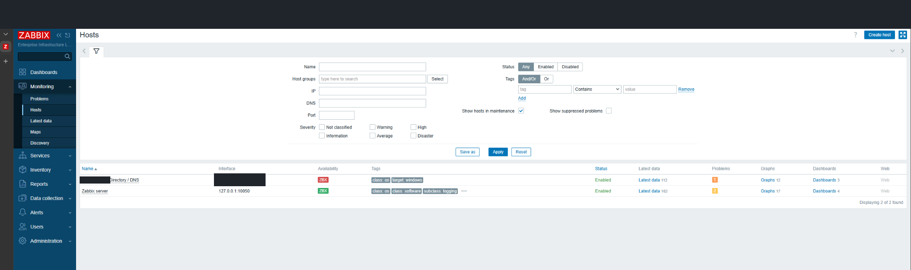

## 138 — Recording the five-minute problem

Zabbix recorded the October 30 monitoring problem from 23:07:16 to 23:12:16, then marked it resolved. That is a five-minute recorded problem. A separate warning about a recent restart was still visible.

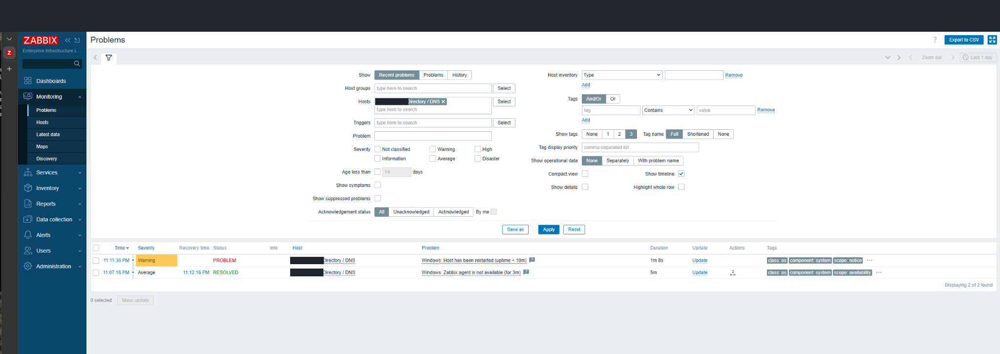

## 139 — Checking both Gmail notifications

I checked the email action log and found both the problem message and recovery message marked Sent through Gmail. The five-minute value describes the recorded problem's duration; it does not tell me how quickly the original failure was detected.

## 140 — Checking service and boot context

I confirmed that the agent was running and set to start automatically, then checked when Windows had last started. I also read nearby startup records to understand what was happening around the interruption.

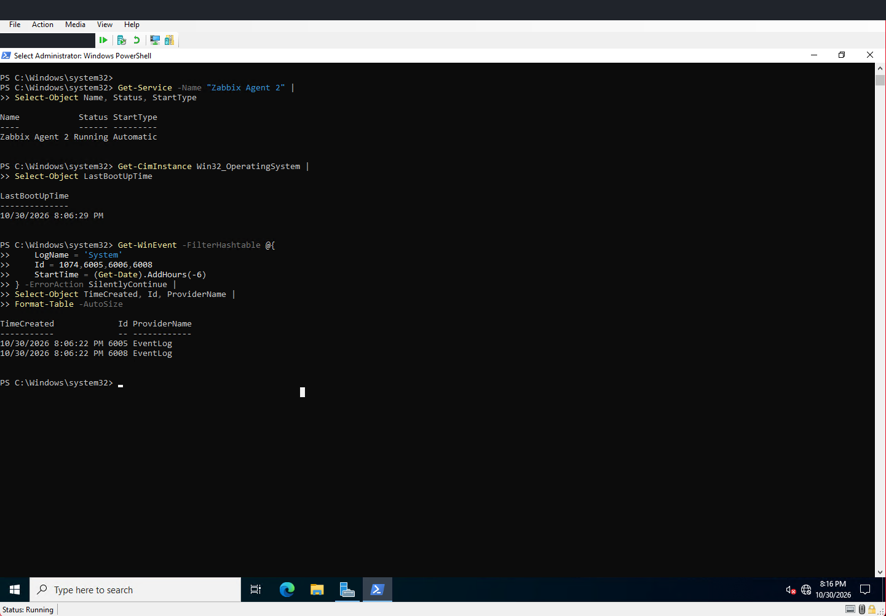

## 141 — Reading the shutdown message carefully

I read the full unexpected-shutdown message carefully. Windows recorded it on October 30, but the message described a shutdown on October 28 at 18:45:59. I kept those two dates separate in my explanation.

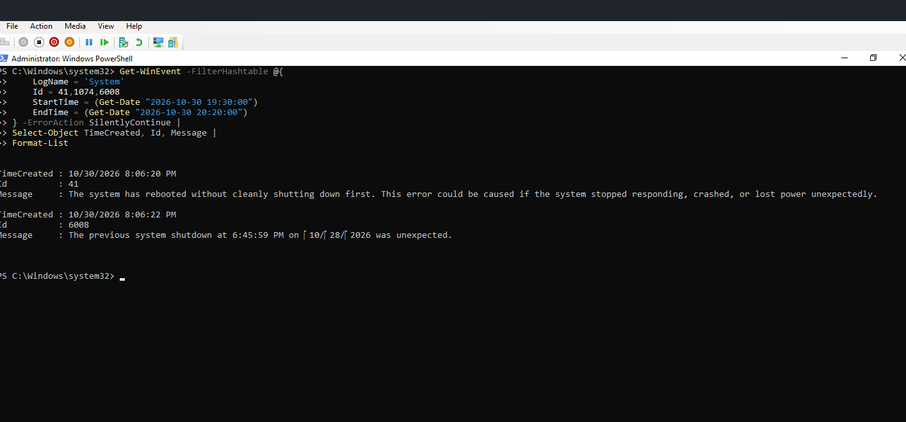

## 142 — Checking the agent's service event

I searched the Windows service log between 20:00 and 20:20. It showed the agent entering the Running state at 20:08:36. No crash event appeared in that limited search, which is different from proving the agent had never crashed.

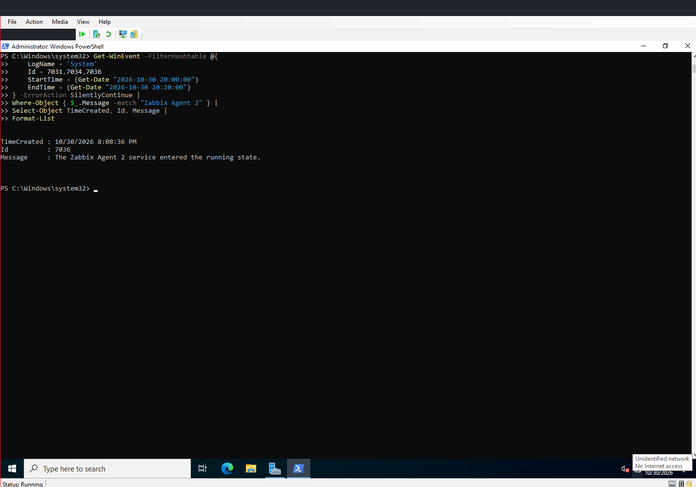
